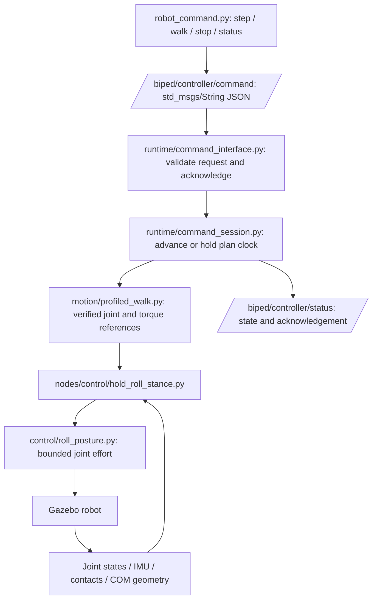

# Launch once, command the robot

This mode starts a persistent Gazebo simulation and a command-driven controller. It does not run a reference/push experiment, create an evidence directory, or close Gazebo after walking. The effort controller keeps holding the robot while waiting for commands.

The first implementation uses the verified straight-ahead trajectory: 75 mm nominal placements, 30 mm sole clearance, 40 mm crouch, 2× movement-phase speed, P54 actuator limits, left initial support. Ten individual foot placements are available per session. A later foot travels 150 mm to pass the supporting foot and land 75 mm ahead. No turning, backward walking, arbitrary velocity command or walking disturbance recovery is implemented.

## 1. Build once after code changes

Open the workspace in VS Code. In its terminal:

```bash
cd '/home/parispoll/Documents/ChatGPT/robotics carrer'
source /opt/ros/jazzy/setup.bash
colcon build --symlink-install --packages-select my_robot_description
source install/setup.bash
```

## 2. Start the robot (terminal A)

Use a separate ROS domain and Gazebo partition so an experiment cannot command this robot accidentally. Use the same values in every terminal that commands this simulation.

```bash
cd '/home/parispoll/Documents/ChatGPT/robotics carrer'
source /opt/ros/jazzy/setup.bash
source install/setup.bash
export ROS_DOMAIN_ID=64
export GZ_PARTITION=biped_interactive
ros2 launch my_robot_description interactive_sim.launch.py
```

The default target real-time factor is now **0.5**, giving sensor transport and GUI rendering more wall time per simulated second. This changes wall-clock pacing, not gait timing, physics step size or motor limits. Set it explicitly when launching:

```bash
# Conservative GUI pacing (default).
ros2 launch my_robot_description interactive_sim.launch.py real_time_factor:=0.5
# Slower pacing if your machine still misses sensor deadlines.
ros2 launch my_robot_description interactive_sim.launch.py real_time_factor:=0.25
# Normal-speed target; requires your machine to keep feedback fresh.
ros2 launch my_robot_description interactive_sim.launch.py real_time_factor:=1.0
```

Do not edit launch files to change speed. Factors above 1.0 are not supported by this command-mode launch.

Gazebo opens with the robot and COM markers. Planning and startup can take a few minutes. Wait for `[roll:ready]`; the robot then remains standing until commanded. `gui:=false` runs the same controller headlessly. Keep this terminal open. Do not launch the experiment runner or the panel's measured trials in the same domain/partition.

## 3. Send commands (terminal B)

Prepare terminal B once:

```bash
cd '/home/parispoll/Documents/ChatGPT/robotics carrer'
source /opt/ros/jazzy/setup.bash
source install/setup.bash
export ROS_DOMAIN_ID=64
export GZ_PARTITION=biped_interactive
```

Then issue one command at a time:

```bash
# Check readiness, completed placements and current state.
ros2 run my_robot_description robot_command.py status

# Make one placement, then hold both feet down.
ros2 run my_robot_description robot_command.py step

# When holding again, perform three ADDITIONAL placements.
ros2 run my_robot_description robot_command.py walk --steps 3

# Finish the placement currently in progress, then hold.
ros2 run my_robot_description robot_command.py stop

# Same controlled stop/hold behavior; does not straighten the crouch.
ros2 run my_robot_description robot_command.py stand
```

For ten uninterrupted placements in a fresh session, use `walk --steps 10`. After one placement and three more, six remain. Requests exceeding the ten-placement capacity are rejected. To start from a fresh abreast stance after using the capacity, stop the launch with Ctrl+C and launch again. There is no in-place world reset/restart command yet.

Each reply contains `accepted`, a message, `ready`, `state`, `completed_steps`, `target_steps`, `capacity_steps`, and `plan_time_s`. Acceptance acknowledges the request, not completion. Use `status` again or monitor:

```bash
ros2 topic echo /biped/controller/status
```

Wait for `state: holding` before issuing another walking request. New walk requests while moving are rejected; they do not replace or queue trajectories. `stop` remains available during motion. This is a controlled stop: it may take the rest of a slow placement to complete. It is not an emergency-stop mechanism.

## 4. Understand the control flow



The high-level command changes **how far the plan clock may advance**. It never writes motor torque directly. Idle mode freezes the reference clock but keeps joint feedback, PID, sensor freshness checks and contact/geometry guards running on actual simulation timestamps. A controlled stop allows the current lift, advance, landing, reload and hold to finish before freezing the reference clock. Resuming continues from those retained world foot positions.

The original experiment launch defaults to `interactive_enabled=false`; its automatic plan clock and audit pipeline remain available. The new `interactive_sim.launch.py` explicitly selects command mode and the verified motor/gait settings. Command mode does not automatically claim that a new run has passed the experiment audits.

## 5. Limits and troubleshooting

- `ready=false`: planning or settling is still under way. Retry status after `[roll:ready]`.
- No acknowledgement: check terminal A, source `install/setup.bash`, and use matching `ROS_DOMAIN_ID`. The client times out after eight wall seconds.
- A guard fails: runtime exceptions are now saved to `evidence/runtime/controller-fault-*.json`, including the traceback, plan state and last sensor stamps. The path is also printed as `[controller:fault-report]`. The launch stops and reports the reason. It does not continue walking with stale sensors or disable limits. Inspect terminal A before restarting.
- Do not pause Gazebo or reset its simulation clock while this controller is active. Its existing wall-time feedback watchdog treats missing feedback as a fault. Shut down and relaunch instead.
- `stand` means hold the current supported posture. Returning from the crouched staggered stance to an upright abreast stance needs another verified motion and is not implemented.

## Implementation files

- `launch/interactive_sim.launch.py`: reproducible command-mode setup.
- `runtime/command_session.py`: ROS-independent state machine and safe pause boundaries.
- `runtime/command_interface.py`: command parsing and status publication.
- `nodes/control/robot_command.py`: terminal client with matching request acknowledgement.
- `nodes/control/hold_roll_stance.py`: existing sensor/control loop, with an optional session clock.
- `tests/test_command_session.py`: idle, startup rejection, safe stop, resume, busy-command rejection and capacity tests.

The live validation record follows.

## Live validation — 14 November 2026

A separate headless ROS/Gazebo session (domain 63, partition `biped_interactive_check`) verified the new interface:

1. After readiness, status reported `holding`, zero completed placements and plan time 0. The robot did not walk automatically.
2. `step` was acknowledged, completed one placement, and stopped at plan time 122.999999 s with `holding`, completed 1.
3. `walk --steps 3` resumed from that held stance and set the target to four total placements.
4. `stop` was acknowledged during the second placement's airborne advance at plan time 184.739999 s. The target changed to two, without freezing the leg.
5. The robot completed landing, reload and hold and reported `holding`, completed 2, plan time 230.999999 s. No guard failure occurred.

Build, two state-machine tests, Python compilation and launch argument inspection passed. This smoke test verifies the interactive command/hold/resume/controlled-stop path. The full six-audit, ten-step gait verification remains the separate saved experiment `20261114-105944-c4c3904f`; this session does not claim another complete ten-step audit. Logs and command replies are retained in `evidence/preparation/interactive-controller/`.

A later `stand` request confirmed sustained holding at the same plan time and two completed placements. A request for nine additional placements was rejected because only eight remained. The test session was then shut down; follow the launch steps above to start your own GUI session.


## Contact-delivery correction

The user's GUI run stopped in the first reload because both contact-source ages reached **53 ms**, exceeding the unchanged **50 ms** bound. This traceback identifies a sensor-freshness rejection; it does not establish a fall or an actuator-limit failure. The underlying scheduling/transport stall was not recorded in enough detail to identify its exact producer.

Interactive control previously consumed the 50 Hz relay topics. It now subscribes directly to `/biped/state/left_foot/contacts` and `/biped/state/right_foot/contacts`, published from the 100 Hz source-stamped Gazebo probe. The unused relay is omitted in interactive mode. Experiment routing is unchanged. This removes an unnecessary relay and its timer scheduling delay; it does not guarantee that an overloaded computer can never miss feedback.

`runtime/contact_routing.py` selects these topics. `interactive_sim.launch.py` now exposes `real_time_factor`, defaults to 0.5, and permits 0.25/0.5/1.0. No freshness, force, motor, geometry or IMU bounds were relaxed.


The contact-delivery fix was tested in a fresh Gazebo GUI session at target real-time factor 0.5. One commanded placement completed through lift, advance, landing and reload, then returned to `holding` at plan time 122.999999 s. Across 13,543 recorded ready-state updates, maximum recorded contact age was 9.0 ms, with zero recorded guard rejections. The test was manually stopped after the hold. The controller and ROS bridges closed cleanly; the Gazebo Ruby wrapper returned exit code 1 during the SIGINT shutdown. There was no controller runtime fault during the step. Build and nine focused tests passed. Evidence: `evidence/preparation/interactive-contact-fix/`. This is a one-step GUI smoke test, not a new ten-step audit or a guarantee against future host scheduling stalls.

## Unloaded contact numerical residue

A later user run failed while beginning the second placement: the supporting right foot carried approximately 218.566 N, while the unloaded left foot's contact decoder rejected a nonpositive-load manifold. This was separate from the earlier stale-message fault.

A headless reproduction captured the same decoder failure during first-foot liftoff: the unloaded right foot had measured force `[4.110239915e-8, -4.110239915e-8, 0]` N. Its contact moment was about `1.24e-9` N m. The previous code accepted only an exactly zero three-component force and moment when normal load was nonpositive. Tiny solver friction residue therefore caused a fault even though vertical load was zero.

`decode_foot_load(..., allow_zero=True)` now normalizes a nonpositive-normal-load manifold to numerical zero only if **each individual contact point's force norm is at most 1e-6 N**, the resultant moment components are at most 1e-6 N m, and all existing schema, frame, contact ordering, force-sign and action/reaction checks pass. Checking each point prevents large opposing forces from cancelling into a false zero. The raw force and moment are preserved separately, and the contact state reports `numerical_zero_normalized`.

This remains `touching_unloaded`, not `no_contact`: only a fresh explicitly empty contact message establishes no contact. Strict bilateral `decode_foot_load` still requires positive vertical load. The 50 ms freshness bound, 0.5 N unloaded-foot guard, load-share and total-weight bands, motor caps and geometry limits are unchanged. The decoder's new numerical floor is explicit; it is not a physical balance-force threshold.

The captured raw manifold is retained as `tests/fixtures/unloaded_solver_residue.json`. Regression tests replay it, preserve raw forces, reject expired evidence, reject significant or opposing cancelling forces, and retain negative-normal-force rejection. Fault reports now include raw contact messages so another decoder rejection can be inspected directly.


After correction, a headless repeat at target real-time factor 1.0 completed two commanded placements and returned to `holding` with completed/target counts 2/2 and plan time 230.999999 s. Across over 24,000 recorded ready-state updates, there were no recorded guard rejections and maximum recorded contact age was 11 ms. No nonzero numerical residue was observed in this repeat; the exact formerly rejected residue is exercised by the captured-sample regression test instead. This is a two-placement smoke test, not a new complete ten-step audit. Evidence and the reproduced pre-fix fault are in `evidence/preparation/unloaded-contact-fix/`. The test was manually stopped after holding.
