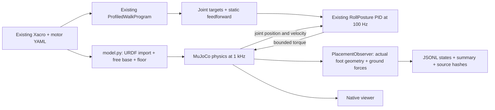

# MuJoCo migration and faster-walking laboratory

The MuJoCo simulator lives beside the existing ROS 2/Gazebo simulator. The original Xacro and P54 actuator YAML remain the authoritative robot definition. This is a simulator adapter, not a replacement robot or a claim that all Gazebo audits already pass in MuJoCo.

## Install and launch

Run from the project root. Installation uses an isolated environment and needs no administrator password:

```bash
cd '/home/parispoll/Documents/ChatGPT/robotics carrer'
bash scripts/mujoco/setup.sh
bash scripts/mujoco/run.sh --viewer --seconds 60 \
  --output evidence/mujoco/my-standing-01
```

Close the viewer to stop early. Choose a fresh output folder each time, so an earlier result cannot be overwritten. Without `--viewer`, physics runs as fast as the CPU can execute it; the viewer paces physics to real time. Neither changes the gait's simulated speed.

Transfer the current three-step gait:

```bash
bash scripts/mujoco/run.sh --mode walk --steps 3 --time-scale .5 --viewer \
  --output evidence/mujoco/my-walk-01
```

The existing trajectory generator still needs time to calculate its inverse-kinematics paths **before the viewer opens**. This startup delay is distinct from simulation speed. There are three simulated seconds of standing before the gait starts. The conservative .5 gait lasts 339 seconds plus startup standing; it is deliberately slow.

Use `--time-scale .25` for the faster comparison candidate. A smaller number shortens movement phases; protected contact-confirmation holds remain. Do not equate completing the loop with passing every balance or geometry criterion.

The local web panel on port 8765 still controls Gazebo. These MuJoCo commands launch a separate native viewer; the panel has not been silently redirected.

## What each new file does

| File | Job |
|---|---|
| `tools/mujoco_biped/model.py` | Expand Xacro, import URDF, add floor/free pelvis/torque actuators, check mass and forward-kinematics parity. |
| `tools/mujoco_biped/simulate.py` | Run 1 kHz physics and the shared 100 Hz torque controller, viewer, safety stop, provenance and state recording. |
| `tools/mujoco_biped/validation.py` | Observe actual sole-corner clearance and loaded landings independently of planned phase names. |
| `tools/mujoco_biped/render.py` | Render the real imported model to PNG for visual inspection. |
| `scripts/mujoco/setup.sh` | Install pinned dependencies into `.runtime/mujoco-venv`. |
| `scripts/mujoco/run.sh` | Set P54 selection and Python paths, then start the standalone adapter. |
| `tests/test_mujoco_migration.py` | Verify free base, mass/FK, torque limits, damping, collision masks and absence of false static steps. |

Shared existing files are imported rather than copied: `model/roll_stance.py`, `model/roll_actuators.py`, `control/roll_posture.py` and `motion/profiled_walk.py`. No ROS nodes, controller manager or Gazebo plugins are launched in this adapter. Xacro is read from the existing Jazzy installation.

## Physics assumptions and the first conversion bug

- 10 actuated hinges, 6 unactuated floating-base velocities; no pelvis weld or external stabilization force.
- Total mass 22.28 kg, same dimensions, joint ranges, output-torque caps and native viscous damping as the P54 Gazebo baseline.
- The original controlled Gazebo model explicitly removes Coulomb joint friction. The adapter also sets imported `frictionloss` to zero.
- Robot self-collision is disabled to match that baseline. Otherwise overlapping shin/foot geometry at the ankle generates artificial internal contacts. The initial conversion failed after 0.59 seconds; matching collision masks resolved it. This does not establish that the geometry is safe for self-collision-enabled tests.
- Flat floor, gravity 9.81 m/s², 1 ms timestep, `implicitfast` integration. Contact and solver physics differ from Gazebo; matching geometry does not guarantee identical forces.
- Ideal output torque motors with clipping and a 2.4 rad/s observed-speed stop; no electrical, thermal, backlash, gearbox efficiency, torque-speed curve or rotor model has been added. The existing case-inertia approximation is retained. These remain simulation assumptions, not a complete physical actuator model.

## Evidence and interpretation

`evidence/mujoco/stand-verified-01/summary.json` records a completed 30-second standing test, no source changes during measurement, maximum tilt about 0.0002704 rad and maximum requested torque about 8.02% of its joint cap. Mass and link-origin parity pass. Two migration unit tests also pass.

`walk-transfer-02` completed a three-placement reference without falling, with 0.187827 m COM progress and peak requested motor fraction 0.53404. It predates the independent placement observer and must not be presented as a verified measured step count.

Subsequent comparison runs include actual foot geometry and ground forces in `state.jsonl`, actual observed placements in `summary.json`, and request/model/source hashes. A basic placement requires all sole corners more than 5 mm above ground with less than 1 N vertical force, followed by five 100 Hz samples above 5 N and below 1 mm minimum sole-corner height. Walking checks require the requested number of alternating placements, each advancing more than 50 mm, without a fall, speed violation or requested motor saturation. This is a migration-level check; it does **not** replace the earlier submillimeter tracking, complete contact coverage, slip, force tracking and independent IMU audits.

## Development path

1. Establish standing and measured alternating-step baselines in MuJoCo.
2. Compare timings using measured COM displacement per simulated second, actual clearances/landings, torque demand and slip. Never use wall-clock speedup as gait improvement.
3. Add explicit contact-phase transitions and support-foot slip/COM/capture-point measurements to the new adapter before promoting more aggressive commands.
4. Develop a shorter-cycle, dynamically balanced gait: swing-foot trajectories and COM planning with contact-aware inverse dynamics. The old static-transfer trajectory is useful for migration, but time compression alone is not a route to human-like speed.
5. Introduce an RL environment alongside that explainable controller, with the same model, actuator budgets and independent evaluation. Squats and jumping follow walking stability and actuator-model checks.

MuJoCo supports URDF import and native MJCF model descriptions; the Python package supplies the physics engine and a passive viewer. References: [official modeling guide](https://mujoco.readthedocs.io/en/stable/modeling.html), [official Python bindings/viewer guide](https://mujoco.readthedocs.io/en/stable/python.html). We pin version 3.3.7 for reproducibility rather than claiming it is the latest release.

## First measured speed comparison

Both runs use three 75 mm nominal placements, the same robot, controller and motor limits, and no velocity-feedforward option. The speed denominator includes the initial three-second standing period and the final hold.

| Measurement | Timing .5 baseline | Timing .25 candidate |
|---|---:|---:|
| Simulated duration | 342.001 s | 185.500 s |
| Measured COM progress | 0.187827 m | 0.187462 m |
| Average forward speed | 0.5492 mm/s | 1.0106 mm/s |
| Actual alternating placements | 3 | 3 |
| Peak joint speed | 0.07542 rad/s | 0.15107 rad/s |
| Peak requested torque / cap | 53.40% | 53.46% |
| Basic migration checks | pass | pass |

The candidate's average measured speed is **1.8401 times the baseline**. This is a promising MuJoCo result, not a claim of fast dynamic walking or cross-simulator equivalence. The gait still spends considerable simulated time transferring weight. Evidence: `evidence/mujoco/walk-baseline-verified-01`, `walk-faster-verified-01`, and `speed-comparison.json`. Failed conversion and preliminary runs remain alongside the successful evidence.



## Ten-placement confirmation

`evidence/mujoco/walk-ten-faster-01/summary.json` completed the .25 candidate with **10 independently observed alternating placements**, 0.712236 m COM progress, 588.001 simulated seconds, 0.15107 rad/s peak joint speed and 53.4616% peak requested motor utilization. No fall, motor-speed stop, requested torque saturation or source change occurred. Maximum pelvis tilt was 0.010307 rad (about 0.591°). All migration-level checks passed; the stricter Gazebo geometry/slip/load audits are still to be ported.

Reproduce visually:

```bash
cd '/home/parispoll/Documents/ChatGPT/robotics carrer'
bash scripts/mujoco/run.sh --mode walk --steps 10 --time-scale .25 --viewer \
  --output evidence/mujoco/my-ten-step-view-01
```

The simulator completed 588 simulated seconds in about 22.4 seconds of headless physics/controller execution, excluding trajectory construction. **That CPU throughput is not walking speed**. With the paced viewer the same gait lasts about 588 real seconds, plus trajectory construction. The next walking-controller change should target shorter weight-transfer cycles with contact-aware COM control, after adding measured support-foot slip and tracking audits.
