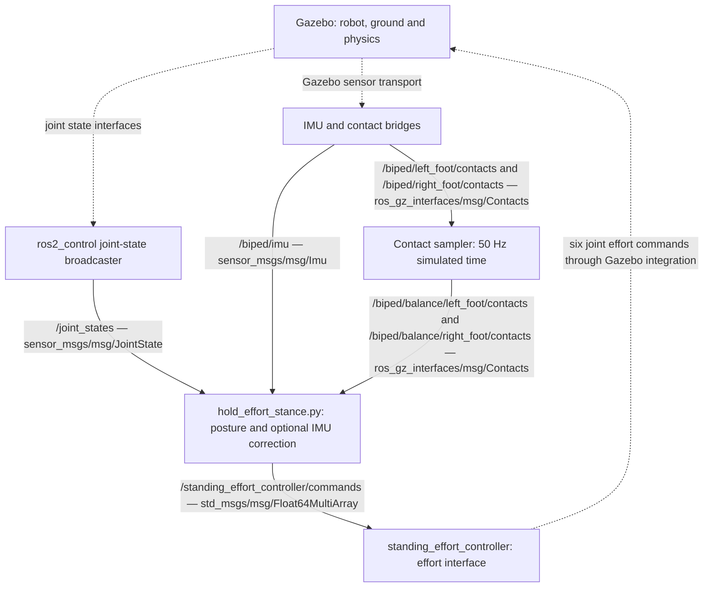

# Learning through our simulated biped

Verified against the handoff, active-balance guide, paired-04 validation and source on 2026-10-28. All 19 source/configuration hashes listed in paired-04 match the current package. No simulations or tests were rerun for this educational review; the combined record reports a successful build and 119 tests.

## What we have achieved

The original goal—getting a humanoid-style robot standing in Gazebo—is achieved. Our current robot is a simplified biped: free pelvis, two thighs, two shins and two feet. Each leg has hip, knee and ankle pitch joints: six actuated joints altogether. Pitch means forward/backward rotation. It is not yet a complete humanoid with lateral leg control or arms.

The project progressed from position-controlled standing to calculated crouching, sensor measurement, repeatable pushes and finite-effort joint PID control. Motor torque caps are ±6, ±10 and ±6 N m for hip, knee and ankle on each leg. Optional IMU feedback now adds a bounded ankle correction. A separate explicit viscous-damping plugin supplies passive joint damping.

The typical crouch per leg is [-0.224080, 0.400000, -0.175920] rad. For the upright pelvis and flat feet, hip + knee + ankle = 0. Radians measure angles; 1 rad is about 57.3 degrees. The knee bend is about 22.9 degrees. Joint signs follow our model's joint axes, rather than a universal anatomical convention.

## What the latest experiment says

Feedback off still means joint PID is running; only the additional IMU ankle correction is absent. Each of the four trials had a fresh no-push reference.

| Requested pelvis push | Peak pitch off → on | Peak reduction | Last outside any recovery band off → on |
| --- | --- | --- | --- |
| +2 N for 0.2 s | 0.335° → 0.286° | 14.6% | 0.712 → 0.988 s |
| -2 N for 0.2 s | 0.486° → 0.390° | 19.7% | 4.198 → 0.706 s |

Positive X is forward. A newton (N) measures force; a newton metre (N m) measures torque. These return times are the last recorded samples outside any configured return band, measured from force-clear publication. They are not a universal settling-time guarantee.

All four push trials passed recovery, contact, command accounting and saturation checks. Forward return was about 0.276 s slower with IMU feedback despite the smaller peak; backward return was faster. Rate feedback resists motion, including motion back toward upright, which can help explain the tradeoff; these pairs alone do not establish its full cause.

The separate 30 simulated second active standing record passed: maximum IMU tilt about 0.00484°, stable pelvis height about 0.554486 m, fresh contact evidence from both feet and no command saturation.

Existing measured plots: [forward comparison](../../evidence/active-balance/paired-04/forward-comparison/comparison.png) and [backward comparison](../../evidence/active-balance/paired-04/backward-comparison/comparison.png).

## What remains unvalidated

There is only one matched off/on pair per direction at these small pushes. The study matches requested pulses and published windows, not independently measured force impulses. Torque traces are commands, not calibrated physical motor-torque measurements. Contact messages establish fresh ground collision evidence, not support-force distribution.

Active IMU balance has not received the earlier joint-PID controller's three-timestep validation. Repeated trials, larger disturbances, noise/delay, contact loss and longer operation need investigation. One backward-on log has subscription teardown errors after requested SIGINT and after recording validation; it remains preserved.

Lateral balance, single support, stepping, walking, terrain adaptation and hardware are not achieved.

## Learning sequence

1. **Robot geometry and signs:** sketch one leg; explain its three angles, flat feet and the crouch equation.
2. **Launch and startup:** follow model/configuration loading, Gazebo spawning, joint-state broadcaster startup, effort-controller configuration and posture-node activation. This is a dependency diagram, not a topic graph.
3. **Runtime measurements:** follow joint states, IMU and sampled contacts. Explain message types, timestamps and simulated time.
4. **Joint torque mathematics:** build from one error to proportional, derivative, static feedforward and bounded integral terms; explain final motor clipping and anti-windup.
5. **Body feedback:** convert IMU orientation/rate, explain the ankle reaction sign, then add freshness gates and the ramp.
6. **Experiments and evidence:** separate reference, pulse, recovery, recordings, audits and plots. Read one plot before studying the comparison automation.

Each lesson should introduce a small actual code excerpt, a numerical example and a question to check understanding before adding detail. The four diagram layers will be startup/launch, runtime feedback, controller mathematics and experiment/logging/validation.

## First diagram: the high-level runtime loop

Solid arrows below are ROS topics, with exact topic names and message types. Dashed arrows are local software/physics interactions, not ROS topics. Gazebo-to-ROS sensor bridges are grouped to keep this first diagram compact. Launch dependencies and file operations are deliberately deferred to their own diagrams.



The contact sampler is launched for active balance and preserves original message timestamps. The posture node calculates commands on joint-state callbacks. Its IMU subscription also supports tilt safety checks when active balance is off. The separate read-only observer does not publish motor commands. Passive damping acts in Gazebo separately from the motor command path. The /clock bridge supplies simulated time; it will be shown in the runtime-detail layer.

## A first small piece of real code

From `my_robot_description/posture_effort.py`:

```python
error = [goal - actual for goal, actual in zip(target, position)]
proportional = [gain * e for gain, e in zip(kp, error)]
```

For one knee, target 0.400 rad and measured angle 0.390 rad give error +0.010 rad. With knee Kp = 100 N m/rad, the proportional contribution is +1 N m. This is one contribution, not the final knee command: static feedforward, velocity feedback, integral correction and the motor cap still matter.

For body pitch θ and pitch rate θ_dot, the optional correction per ankle is:

`ramp * clip((20*θ + 4*θ_dot)/2, -0.5, +0.5)`

Here θ is radians, θ_dot is rad/s, gains are N m/rad and N m s/rad, and the result is N m. Positive forward pitch requests positive ankle torque because the reaction on the upper robot opposes forward lean. Both ankles share the request equally under a double-support approximation. Fresh IMU and both-foot contact evidence are required; the ramp takes one simulated second after posture readiness.

## Proposed development road ahead

After educational consolidation: repeat and characterize current balance; validate support forces and geometry; attempt controlled double-support weight transfer; extend the model for lateral control; validate single support and stepping; then work toward slow controlled walking.

The long-term direction is a simulated biped with understandable, reproducible balance and walking under finite actuator limits. Hardware would require a separately agreed scope and new validation.

Next lesson: draw one leg, label positive joint rotation and explain why the crouch angles sum to zero. Check understanding: if the knee target stays at 0.400 rad and the measured knee angle becomes 0.410 rad, what sign should the proportional torque contribution have?
