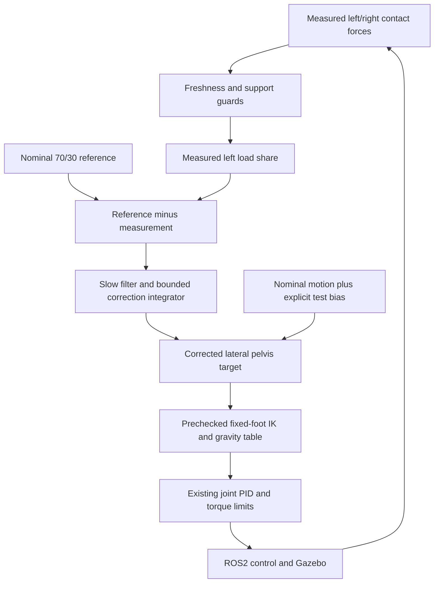

# First measured foot-load feedback loop

> Later development: the physical-pulse milestone adds P54-only roll velocity damping and a level front camera. See [the current physical-pulse guide](P54_LATERAL_PUSH_PANEL.md). Results below retain their original controller version.

This milestone adds an outer feedback loop around our existing joint posture controller. Both feet remain planted. The new loop uses measured vertical foot forces to adjust a small lateral pelvis offset; the existing PID still produces joint torque commands.

## 1. What changed in behavior

Before, the robot followed a geometric weight-transfer plan. Measured forces could stop the experiment when a guard failed, but did not change the target posture.

Now, in the explicit `--load-feedback` mode, the controller compares the desired and measured left-foot load shares. If the left foot carries too much, it moves the pelvis target slightly right. If it carries too little, it moves the target slightly left. Left/right directions use the same world-coordinate rule.

This regulates load distribution through posture. It does not command ground force directly, implement ankle pressure control, or establish single-leg balance.

## 2. The equations

Measured left share:

`measured = F_left / (F_left + F_right)`

Desired left share comes from the nominal transfer program, so it changes smoothly from 50% to 70% for a leftward 70/30 transfer. For a rightward transfer it changes from 50% to 30%.

`error = desired_left_share − measured_left_share`

A positive error means the left foot needs more load, so the correction should move the pelvis toward world +Y, the robot's left.

Filter the error with time constant 1.0 simulated second:

`alpha = dt / (1.0 + dt)`

`filtered_error += alpha × (error − filtered_error)`

Convert that error into a bounded pelvis correction velocity:

`correction_velocity = clip(0.04 × filtered_error, −0.002, +0.002) m/s`

Then integrate and clamp the position correction:

`correction = clip(correction + correction_velocity × dt, −0.004, +0.004) m`

The gain has units of metres per second per unit load fraction. An error of one percentage point is 0.01, not 1; before filtering/rate limiting it therefore requests `0.04 × 0.01 = 0.0004 m/s`.

The correction state itself is clamped, preventing accumulated position windup beyond ±4 mm. A zero timestep freezes the update. Missing, stale or ineligible forces are rejected before integration; force data are never replaced with guessed zero values.

## 3. Applying the correction to joints

The command target is

`pelvis_command = nominal_pelvis + test_bias × nominal_progress + correction`.

For ordinary use, `test_bias = 0`. The optional bias is a controlled validation input described below.

A 201-point fixed-foot table covers the entire possible command interval before activation. Each point is checked against existing joint limits, bilateral support assumptions and 80% static motor budgets. The control callback interpolates joint targets and gravity feedforward from this table; it does not parse the URDF or run a new optimizer in the active loop.

The joint PID gains, motor caps, actuator masses and physical damping are unchanged. The observer/COM expectation still uses the 22.28 kg P54 model.

## 4. Timing and guards

The joint controller runs at its existing nominal rate. Outer updates occur only on recorded control ticks, approximately every 12 simulated milliseconds in the current system. This makes every outer update available for replay from the saved log. Between updates, the correction is held while the nominal motion continues.

The force inputs come from the existing sampled bilateral contact messages, with their original source timestamps. The existing safety guard still checks both feet, source age and summed weight. The new update also checks eligible forces, age and the 25% support floor. It does not act on stale feedback.

The unchanged runtime guards include:

- At least 25% of measured vertical support on each foot.
- Force source ages from −0.02 to +0.05 simulated seconds.
- Total vertical reaction within 5% of model weight.
- Requested motor commands below 80% of their caps during unloading.
- Existing posture, IMU, joint timing, operating speed and contact requirements.

Offline audits reconstruct the applied joint targets including correction, check the PID command composition, and replay every recorded outer-loop state. Raw contact measurements separately validate physical load transfer.

## 5. Why use a deliberate 3 mm reference offset?

The previous nominal trials already reached approximately 29.99% on the lighter foot. There is little systematic error for a new loop to improve.

For a controlled comparison, both feedback-off and feedback-on runs receive the same **3 mm target offset toward the loaded side**. It grows and shrinks with nominal movement, so it is absent at centered baseline and at the end of the return. It is a reference-error injection, not an external push, modified sensor reading or changed robot model.

The feedback reference remains the original 70/30 load split. Thus the off case should follow the biased posture, while the on case should use measured forces to reduce the resulting load-share error. The ±4 mm correction range is large enough to cancel the 3 mm test bias, while remaining bounded.

The geometric audits account explicitly for the intentionally biased target in the off case. They do not loosen motion tolerances. The force-error comparison always uses the unchanged nominal load reference, with late-hold measurements from independent raw contact records.

The key comparison is mean absolute load-share error during the last two seconds of the hold. A useful first acceptance target is at least 50% error reduction with all existing motion, sensor, load and motor checks passing. This does not establish push recovery or response to arbitrary physical disturbances.

## 6. Code organization

| File | Responsibility |
|---|---|
| `src/my_robot_description/my_robot_description/load_feedback.py` | Pure load-share filter/integrator, bounded command workspace and recorded-state replay audit |
| `src/my_robot_description/scripts/hold_roll_stance.py` | ROS adapter: receive eligible forces, update the outer loop on recorded ticks and apply the corrected posture |
| `src/my_robot_description/my_robot_description/lateral_audit.py` | Reconstruct the corrected joint/torque targets for command auditing |
| `src/my_robot_description/launch/roll_standing.launch.py` | Explicit feedback-enable and reference-bias parameters |
| `scripts/run_lateral_shift.py` | CLI setup, correct nominal/biased expectations and outer-loop audit |
| `scripts/reaudit_lateral_shift.py` | Reconstruct the recorded feedback program when replaying evidence |
| `scripts/analyze_foot_loads.py` | Label force usage correctly for active-feedback runs |
| `tests/test_load_feedback.py` | Sign, filtering, disabled behavior, clipping recovery, rate bounds, stale-input rejection, known-bias correction and replay corruption tests |

Existing standing, small-shift and partial-unloading modes retain their behavior unless the new options are explicitly selected. The feedback experiment requires the P54 profile and partial-unloading mode.

## 7. Reproduce

From the workspace:

```bash
source /opt/ros/jazzy/setup.bash
colcon build --symlink-install --packages-select my_robot_description
source install/setup.bash

# Comparator: same deliberately biased reference, feedback disabled.
python3 scripts/run_lateral_shift.py --actuator-profile robotis_p54 \
  --unload-fraction 0.3 --direction left --load-reference-bias 0.003 \
  --output evidence/my-load-feedback-off-01

# Measured load-share correction enabled.
python3 scripts/run_lateral_shift.py --gui --actuator-profile robotis_p54 \
  --unload-fraction 0.3 --direction left --load-reference-bias 0.003 \
  --load-feedback --output evidence/my-load-feedback-on-01
```

Use fresh output folders. For ordinary feedback-enabled transfer, omit `--load-reference-bias`. For a mirrored test, use `--direction right`; a positive test-bias magnitude then points toward the right loaded foot. The feedback law still uses world +Y as its positive correction direction.

All results here concern bilateral support. Zero-load contact interpretation and foot lifting require separate development and validation.

## 8. The first live tuning failure

The first enabled trial, `evidence/load-feedback-on-left-01`, used a gain of 0.12 m/s per unit share and a 0.2 s filter. Its held left share reached about 69.973%, closer to the nominal 70% than the biased comparator's 71.144%.

However, its return was unacceptable: the final COM excursion reached about 9.25 mm, joint tracking/speed and IMU checks failed, and independently reconstructed force/pressure checks also failed. It remains a failed run. A good held average did not compensate for an unstable recovery.

The recorded recovery error had a dominant frequency near 0.8 Hz. We reduced gain threefold to 0.04 and increased the filter time constant to 1.0 s. The aim is to correct slow load bias while reacting less strongly to the robot's motion-dependent force variations. No inner-loop gain, motor cap or acceptance threshold was relaxed.

The disabled comparator's exact source is saved as `load_feedback-source.py`. Its raw data pass replay with the revised code. The comparison tool verifies that its package-source difference from the tuned enabled run is restricted to the outer gain/filter constants, whose calculation branch is disabled in the comparator. This avoids silently comparing different robot models or joint controllers.

## 9. Signal flow



The new module's independent responsibility is the slow force-to-posture correction. It does not replace the sensor guard, joint PID, model planning or raw-data audits.

## 10. Verified results

The package build and all **278 unit tests passed**. The comparator, tuned enabled run and mirrored GUI run each passed the original motion, IMU, COM, measured-force, contact, motor and damping checks. The first faster enabled run remains failed and preserved.

| Trial | Late-hold mean absolute share error | Peak pelvis correction | Final COM peak offset |
|---|---:|---:|---:|
| `load-feedback-off-left-01` | 1.1439 percentage points | 0.0000 mm | 0.3146 mm |
| `load-feedback-on-left-02` | 0.2151 percentage points | 2.7684 mm | 0.5523 mm |
| `load-feedback-on-right-01` | 0.2149 percentage points | 2.7671 mm | 0.5533 mm |

The matched leftward comparison reduced late-hold error by **81.19%**. The tuned loop never clipped its ±4 mm correction and retained the original 25% measured support floor and 80% motor bound. The maximum final pelvis offset was approximately 0.86 mm in the enabled cases, below the unchanged 1 mm criterion. The controller regulates the held split more accurately under this test bias; it does not make recovery perfect.

The final report and plots are in `evidence/load-feedback-comparison-01/`. To regenerate in a new output folder:

```bash
python3 scripts/analyze_load_feedback.py evidence/load-feedback-off-left-01 \
  evidence/load-feedback-on-left-02 --mirror evidence/load-feedback-on-right-01 \
  --output evidence/my-load-feedback-comparison-01
```

The next step should validate this slow loop under a small physical disturbance or a justified model mismatch while retaining bilateral support. Single-support transitions still require reliable zero-load contact handling and a suitable posture/pressure controller.
