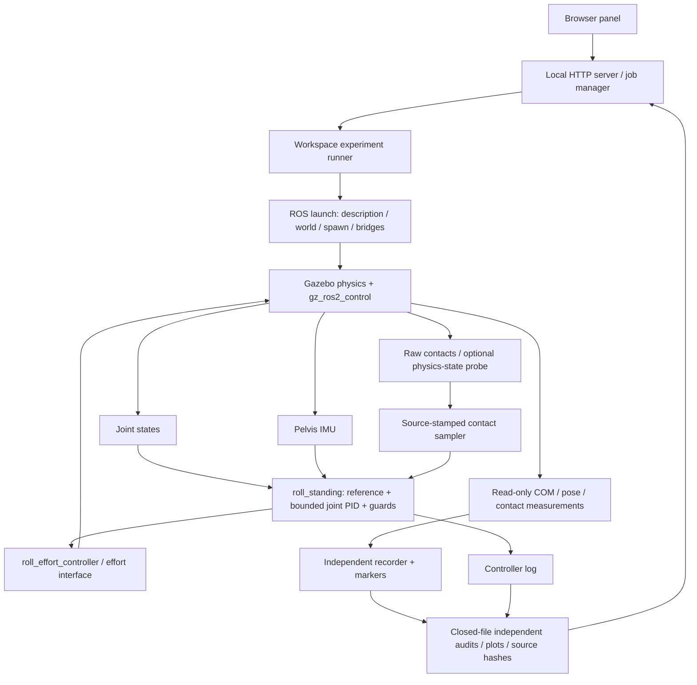

# Τεχνική αναφορά και παράδοση biped project

**Ημερομηνία ελέγχου: 11 Νοεμβρίου 2026.** Βάση της αναφοράς είναι ο τοπικός πηγαίος κώδικας, τα `summary.json`, οι καταγραφές και τα source hashes· όχι μόνο το ιστορικό της συνομιλίας. Δεν εκτελέστηκε νέο πείραμα, build ή πλήρης σουίτα δοκιμών για τη σύνταξή της.

Workspace: `/home/parispoll/Documents/ChatGPT/robotics carrer`.
Αυτός είναι ο φάκελος που ανοίγουμε στο VS Code. Η αναφορά χρησιμοποιεί διαδρομές σχετικές με αυτόν, εκτός αν δηλώνεται διαφορετικά.

## 1. Τρέχουσα κατάσταση σε μία σελίδα

Έχουμε λειτουργικό, ελεύθερο biped σε **ROS 2 Jazzy / Gazebo Harmonic**, με πεπερασμένες εντολές ροπής, μετρήσεις, ανεξάρτητους ελέγχους και GUI πειραμάτων. Το τελευταίο επαληθευμένο μοντέλο έχει **10 ενεργές αρθρώσεις**, 5 ανά πόδι, και επιλεγμένο actuator profile **`robotis_p54`**. Δεν είναι το παλιό μοντέλο 6 αρθρώσεων που περιγράφουν αρκετές αρχικές σελίδες του README.

Το τελευταίο επιτυχημένο ορόσημο είναι **σχεδόν πλήρης αποφόρτιση του ενός ποδιού, και στις δύο πλευρές, με επιστροφή στην αρχική στάση**. Η λεκάνη χαμηλώνει 40 mm και μετατοπίζεται περίπου 132 mm. Το άλλο πέλμα παραμένει ελαφρά σε επαφή: περίπου **0.0035 N** μέση κατακόρυφη δύναμη στο ελεγχόμενο hold. Αυτό περνά το λειτουργικό κριτήριο zero-load ≤0.5 N, **δεν είναι ακριβώς μηδενική δύναμη ούτε εκτελεσμένη ανύψωση**.

| Ικανότητα | Πραγματική κατάσταση |
|---|---|
| Όρθια στάση με position interfaces, 6 αρθρώσεις | Υλοποιημένη και δοκιμασμένη ιστορική βάση |
| Στάση με bounded effort/PID, 6 αρθρώσεις | Υλοποιημένη, με μετρημένες δοκιμές ανάκαμψης |
| IMU pitch/rate ankle balance, 6 αρθρώσεις | Προαιρετικά υλοποιημένο και συγκριτικά δοκιμασμένο |
| Στάση με 10 αρθρώσεις και P54 masses/caps | Υλοποιημένη και επαληθευμένη |
| COM visualization, contact forces, CoP audits | Υλοποιημένα, με τους περιορισμούς που αναφέρονται παρακάτω |
| Αργή πλευρική μεταφορά, χαμήλωμα, 20/10/5% αποφόρτιση | Επαληθευμένα και προς τις δύο πλευρές |
| Μετρημένο load-share feedback | Υλοποιημένο σε ξεχωριστό bilateral mode |
| Zero-load hold και επιστροφή | Επαληθευμένα με αριστερή και δεξιά στήριξη |
| Φρέσκια ένδειξη απουσίας επαφής | Υλοποιημένη και δοκιμασμένη σε ξεχωριστό fixture |
| Σκόπιμη ανύψωση, swing, landing | **Δεν έχουν υλοποιηθεί ως εκτελεσμένο robot experiment** |
| Βάδιση, διαδοχικά βήματα, yaw/στροφή | **Δεν έχουν επιτευχθεί** |
| Hardware ή πιστό ηλεκτρομηχανικό motor model | **Δεν υπάρχουν** |

**Ακριβές επόμενο βήμα:** προετοιμασία ξεχωριστού πειράματος μικρής κατακόρυφης ανύψωσης του αποφορτισμένου πέλματος, πάνω στην επαληθευμένη zero-load στάση. Πρώτα σχεδιασμός/έλεγχοι, μετά μία πλευρά, κατόπιν κατοπτρική δοκιμή. Δεν ξεκινάμε ακόμη βάδιση.

## 2. Μοντέλα, γεωμετρία και παραδοχές

### 2.1 Τα μοντέλα που συνυπάρχουν

| Αρχείο Xacro | Χρήση |
|---|---|
| `urdf/my_biped.urdf.xacro` | Αρχική βάση 6 pitch joints, position control |
| `urdf/effort_standing.urdf.xacro` | 6 pitch joints, finite-effort studies |
| `urdf/biped_roll.urdf.xacro` | Γεωμετρία μοντέλου 10 αρθρώσεων |
| `urdf/roll_effort.urdf.xacro` | Τρέχον ten-joint effort μοντέλο με matching command bounds |
| `urdf/torque_bench.urdf.xacro` | Ανεξάρτητο μονοαρθρωτό test bench |

Όλες οι παραπάνω διαδρομές είναι κάτω από `src/my_robot_description/`. Το Gazebo model ονομάζεται **`my_biped`**, ο κόσμος **`standing`**, και ο κεντρικός ROS frame **`base_link`**. Η βάση είναι ελεύθερη: δεν υπάρχει στατική λεκάνη, world-support joint ή planar guide στο ενεργό μοντέλο.

Το ten-joint μοντέλο έχει 11 links: βάση και, σε κάθε πλευρά, hip-roll carrier, thigh, shin, ankle-pitch carrier και foot. Οι carriers έχουν αρχική μάζα 0.08 kg, θετική αδράνεια και δεν έχουν collision geometry. Δεν υπάρχουν χέρια, πλήρης κορμός/κεφαλή ή hip yaw.

### 2.2 Σειρά αρθρώσεων — κρίσιμη για τις εντολές

```text
0 left_hip_roll       5 right_hip_roll
1 left_hip_pitch      6 right_hip_pitch
2 left_knee_pitch     7 right_knee_pitch
3 left_ankle_pitch    8 right_ankle_pitch
4 left_ankle_roll     9 right_ankle_roll
```

Οι roll άξονες είναι τοπικά +X και οι pitch +Y. Στον κόσμο χρησιμοποιούμε +X εμπρός, +Y αριστερά και +Z πάνω. Τα ονόματα `left_hip`, `left_knee`, `left_ankle` ανήκουν στο παλιό six-joint μοντέλο, όχι στο νέο interface.

| Παράμετρος | Τιμή |
|---|---:|
| Μηρός / κνήμη | 0.26 / 0.26 m |
| Πέλμα X × Y × Z | 0.20 × 0.12 × 0.045 m |
| Κέντρα ισχίων/πελμάτων σε ουδέτερη στάση | Y=±0.085 m, απόσταση 0.17 m |
| Βάση X × Y × Z | 0.18 × 0.22 × 0.16 m |
| Hip roll / ankle roll όρια | ±0.35 rad |
| Hip pitch όρια | ±1.2 rad |
| Knee pitch όρια | 0 έως 2.4 rad |
| Ankle pitch όρια | ±0.8 rad |
| Μάζα ten-joint legacy / P54 | 14.42 / 22.28 kg |
| Βάρος P54, g=9.81 | 218.5668 N |
| Κεντραρισμένη συμμετρική στήριξη P54 | 109.2834 N ανά πέλμα |

Η δομική βάση είναι 7.5 kg, κάθε μηρός 1.4 kg, κάθε κνήμη 1.0 kg και κάθε πέλμα 0.9 kg. Οι κινητήρες προστίθενται στη δομική μάζα: δεν προκύπτουν από πλήρες BOM. Το αρχικό six-joint μοντέλο ήταν περίπου 14.1 kg.

Η τρέχουσα P54 ουδέτερη crouch στάση ανά πόδι είναι περίπου:

```text
[roll, hip_pitch, knee_pitch, ankle_pitch, ankle_roll]
[0, -0.2291123, 0.4, -0.1708877, 0] rad
pelvis height ≈ 0.5544187 m
knee static feedforward ≈ -3.54806 N·m
```

Οι παλιές τιμές γωνιών/ροπών για 14.1 ή 14.42 kg δεν πρέπει να αντιγράφονται στο P54 μοντέλο.

### 2.3 Προφίλ κινητήρων

Πηγή: `config/roll_actuators.yaml` και `my_robot_description/roll_actuators.py`.

| Joint ανά πόδι | P54 model abstraction | Cap N·m | Πρόσθετη μάζα kg |
|---|---|---:|---:|
| Hip roll | PH54-200-S500-R | 44.7 | 0.855 |
| Hip pitch | PH54-100-S500-R | 25.3 | 0.740 |
| Knee pitch | PH54-200-S500-R | 44.7 | 0.855 |
| Ankle pitch | PH54-100-S500-R | 25.3 | 0.740 |
| Ankle roll | PH54-100-S500-R | 25.3 | 0.740 |

Η αντιστοίχιση είναι δική μας σχεδιαστική επιλογή, όχι πιστό αντίγραφο THORMANG3. Τα αποθηκευμένα στοιχεία κατασκευαστή αφορούν λειτουργικά σημεία στα 24 V· δεν χρησιμοποιήθηκε αυθαίρετο peak/stall boost. Το operating speed guard είναι 2.4 rad/s και στους δέκα κινητήρες.

Προστίθενται 3.93 kg ανά πόδι. Η μάζα, το COM και η box approximation της αδράνειας κάθε motor case συγχωνεύονται στο child link με parallel-axis theorem. Δεν έχουν επαληθευτεί η πραγματική χωροθέτηση των co-located cases, τα brackets, τα καλώδια ή οι συγκρούσεις των περιβλημάτων.

Το `legacy` παραμένει το **default** αν δεν επιλεγεί profile. Για την τρέχουσα ανάπτυξη χρειάζεται ρητά `--actuator-profile robotis_p54` στον runner ή `BIPED_ACTUATOR_PROFILE=robotis_p54` **πριν** από import/launch. Δεν αλλάζουμε profile μέσα σε ήδη εκτελούμενη διεργασία.

Δεν μοντελοποιούνται current control, torque-speed curve, gearbox backlash, θερμοκρασία, ηλεκτρική ισχύς ή communication delay. Οι εντολές effort παραμένουν ιδανικές εντός ορίων· τα αποτελέσματα δεν είναι πιστοποίηση hardware.

## 3. ROS 2 packages και αρχεία

Υπάρχει **ένα δικό μας ROS package**, `my_robot_description` v0.1.0, με build type `ament_cmake` και εγκατεστημένο Python package μέσω `ament_cmake_python`. Τα `scripts/` στη ρίζα και `tools/force_panel/` είναι εργαλεία του workspace, **όχι χωριστά ROS packages**.

Εξαρτήσεις δηλωμένες στο `package.xml`:

- Build/native: `ament_cmake`, `ament_cmake_python`, `gz_sim_vendor`, `gz_plugin_vendor`, `gz_dartsim_vendor`. Το CMake βρίσκει επίσης `gz-sim8`, `gz-plugin2` και `DART`.
- Launch/model/simulator: `launch`, `launch_ros`, `ament_index_python`, `xacro`, `robot_state_publisher`, `ros_gz_sim`, `ros_gz_bridge`.
- Control: `gz_ros2_control`, `controller_manager`, `joint_state_broadcaster`, `joint_trajectory_controller`, `forward_command_controller`.
- ROS interfaces/runtime: `rclpy`, `control_msgs`, `sensor_msgs`, `trajectory_msgs`, `action_msgs`, `builtin_interfaces`, `ros_gz_interfaces`, `rosgraph_msgs`, `controller_manager_msgs`, `std_msgs`.

Κώδικας χρησιμοποιεί επίσης Python `yaml`, `rosidl_runtime_py`, `gz.transport13`, `gz.msgs10` και βιβλιοθήκες plotting/numerical tools. Το `package.xml` δεν αποτελεί πλήρες lockfile ολόκληρου του περιβάλλοντος· σε νέα εγκατάσταση χρειάζεται έλεγχος των imports.

### 3.1 Launch files — πλήρης λίστα

| Launch | Μοντέλο / controller | Κατάσταση |
|---|---|---|
| `standing.launch.py` | 6 joints, trajectory position interface, straight/crouch | Ιστορικό λειτουργικό baseline |
| `torque_bench.launch.py` | Ένα bench joint, effort | Ανεξάρτητη δοκιμή ροπής |
| `effort_standing.launch.py` | 6 joints, bounded PD/PID, προαιρετικό sagittal IMU balance | Ιστορικά recovery/push studies και visual mode |
| `roll_standing.launch.py` | 10 joints, standing/shift/unloading/lowering/zero-load | Τρέχουσα γραμμή ανάπτυξης |

Το `roll_standing.launch.py` παρέχει `gui`, `recording`, `com_recording`, `damping_recording`, `wrench_debug`, `shift_enabled`, `shift_displacement`, `unload_enabled`, `unload_fraction`, `unload_direction`, `lowering_enabled`, `lowering_distance`, `lowering_lateral_shift`, `lowered_unload_fraction`, `zero_load_enabled`, `load_feedback_enabled`, `load_reference_bias`. Ο runner ελέγχει συμβατούς συνδυασμούς· δεν ενεργοποιούμε πολλά motion programs μαζί.

Το six-joint effort launch διατηρεί ξεχωριστά `controller_mode`, `damping_model`, `balance_enabled`, `balance_kd`, `ankle_balance_limit`, `physics_step`, `real_time_factor`, probe recordings και visual readiness/keep-alive επιλογές. Δεν είναι παράμετροι ενεργού ten-joint IMU controller.

### 3.2 Nodes και εκτελέσιμα

| Node / executable | Ρόλος / πότε χρησιμοποιείται |
|---|---|
| `robot_state_publisher` | Δημοσιεύει URDF και transforms από joint states |
| `spawn_biped`, `ros_gz_sim/create` | Δημιουργεί `my_biped` στον κόσμο· ολοκληρώνεται μετά το spawn |
| `simulation_clock_bridge` | Gazebo → ROS `/clock` |
| `pelvis_imu_bridge` | Gazebo → ROS IMU, `base_link` frame label |
| `left_foot_contact_bridge`, `right_foot_contact_bridge` | Raw επαφές πελμάτων προς ROS |
| Πρόσθετα `parameter_bridge` instances στο zero-load | Physics-state contacts προς ROS |
| `controller_manager` μέσα στο Gazebo plugin | Διαχείριση hardware interfaces και controllers |
| `controller_manager/spawner` | Φόρτωση/ενεργοποίηση controllers, πεπερασμένες startup διεργασίες |
| `roll_standing` / `hold_roll_stance.py` | Πραγματικός ten-joint torque publisher, motion selection, guards, readiness, καταγραφή |
| `standing_effort` / `hold_effort_stance.py` | Six-joint posture και προαιρετική sagittal IMU correction |
| `balance_contact_sampler` / `sample_contacts.py` | Μειώνει το contact traffic για control χωρίς να αλλάζει source timestamps |
| `center_of_mass_visual` / `show_center_of_mass.py` | Παρατηρεί COM/πέλματα και σχεδιάζει markers· δεν στέλνει ροπές |
| `balance_observer` / `observe_balance.py` | Six-joint diagnostic IMU ankle proposal, χωρίς motor publisher |
| `move_to_stance` / `move_to_stance.py` | Position trajectory action client της παλιάς βάσης |
| `plan_stance.py` | Installed calculation executable· όχι συνεχής feedback controller |
| `lateral_sensor_recorder` / workspace `record_lateral_sensors.py` | Ανεξάρτητη καταγραφή pose, IMU, raw/state contacts πριν το warm-up |
| `record_push_experiment` / `push_experiment.py` | Push timing, pose/IMU/contact recordings στην παλιά σειρά |
| `visual_force_pulse` / `run_visual_push.py` | Μία οπτική ώθηση, χωρίς reference/recovery certification |
| `torque_bench_experiment` | Εντολές/μετρήσεις ανεξάρτητου bench |
| `contact_transition_bench` | Ξεχωριστό contact/air/contact fixture diagnostic |

Τα Python analysis/plot scripts δεν είναι αυτομάτως ROS nodes. Το web server επίσης δεν είναι node που ελέγχει αρθρώσεις.

### 3.3 Controllers και interfaces

Όλοι οι συγκεκριμένοι controller-manager configurations ζητούν **250 Hz** (4 ms). Δεν εξισώνουμε το ονομαστικό update rate με το wall-clock pacing ή το αραιότερο log rate.

| Controller | Τύπος | Interface / ρόλος |
|---|---|---|
| `joint_state_broadcaster` | `joint_state_broadcaster/JointStateBroadcaster` | Joint feedback, κοινό στις διατάξεις |
| `joint_trajectory_controller` | `joint_trajectory_controller/JointTrajectoryController` | 6 position commands, παλιά βάση |
| `standing_effort_controller` | `forward_command_controller/ForwardCommandController` | 6 effort commands |
| `roll_effort_controller` | ίδιο forward command plugin | 10 effort commands στην παραπάνω ακριβή σειρά |
| `bench_effort_controller` | ίδιο forward command plugin | Μόνο `bench_joint` |

Ο forward controller **δεν υπολογίζει PID**: προωθεί τις ροπές του Python controller στο `gz_ros2_control/GazeboSimSystem`. Ο PID βρίσκεται στα δικά μας pure modules και ROS adapters. Στο ten-joint startup ο effort controller αρχικά φορτώνεται **inactive** και ο `roll_standing` κάνει ελεγχόμενο switch όταν υπάρχουν συμβατά φρέσκα δεδομένα/ρυθμίσεις.

### 3.4 Topics, action, services — ROS έναντι Gazebo Transport

| Όνομα | Τεχνολογία / τύπος | Χρήση |
|---|---|---|
| `/robot_description` | ROS, περιγραφή URDF | Spawn / model consumers |
| `/tf`, `/tf_static` | ROS transforms | Kinematic frames από robot_state_publisher |
| `/clock` | ROS `rosgraph_msgs/msg/Clock`, από GZ `gz.msgs.Clock` | Κοινός χρόνος προσομοίωσης |
| `/joint_states` | ROS `sensor_msgs/msg/JointState` | Position/velocity/effort feedback |
| `/biped/imu` | ROS `sensor_msgs/msg/Imu`, από GZ `gz.msgs.IMU` | Pelvis orientation, gyro, acceleration |
| `/biped/{left,right}_foot/contacts` | ROS `ros_gz_interfaces/msg/Contacts`, από GZ `gz.msgs.Contacts` | Raw physics contacts/wrenches |
| `/biped/balance/{left,right}_foot/contacts` | ROS `Contacts` | Sampled raw contacts για παλιότερα modes |
| `/biped/state/{left,right}_foot/contacts` | GZ `Contacts` → ROS `Contacts` | Νέο explicit physics-state stream μόνο όταν ενεργοποιείται το probe |
| `/biped/state/balance/{left,right}_foot/contacts` | ROS `Contacts` | Sampled state stream του zero-load controller |
| `/roll_effort_controller/commands` | ROS `std_msgs/msg/Float64MultiArray` | 10 εντολές N·m |
| `/standing_effort_controller/commands` | ίδιος ROS τύπος | 6 εντολές N·m |
| `/bench_effort_controller/commands` | ίδιος ROS τύπος | 1 εντολή N·m |
| `/joint_trajectory_controller/controller_state` | ROS `control_msgs/msg/JointTrajectoryControllerState` | Παλιό position tracking |
| `/joint_trajectory_controller/follow_joint_trajectory` | ROS action `control_msgs/action/FollowJointTrajectory` | Παλιό crouch transition |
| `/controller_manager/switch_controller` | ROS service `controller_manager_msgs/srv/SwitchController` | Ενεργοποίηση effort controller |
| `/controller_manager` parameter services | ROS parameter client | Επιθεώρηση controller configuration |
| `/biped/com_state` | **GZ Transport**, `gz.msgs.Double_V`, όχι ROS topic | COM probe → observer, schema: time, mass, COM xyz, 8 sole corners xyz |
| `/world/standing/pose/info` | **GZ Transport**, `gz.msgs.Pose_V` | Ανεξάρτητη world model pose |
| `/world/standing/wrench/persistent` | **GZ Transport**, `gz.msgs.EntityWrench` | Εφαρμογή ζητούμενης επίμονης δύναμης |
| `/world/standing/wrench/clear` | **GZ Transport**, `gz.msgs.Entity` | Ακύρωση της επίμονης δύναμης |
| `/marker_array` | **GZ service**, `gz.msgs.Marker_V` → `Boolean` | COM/force visualization μόνο |

Τα `{left,right}` σημαίνουν δύο ξεχωριστά ονόματα. Δεν υπάρχει υλοποιημένο `/cmd_vel` → gait pipeline. Δεν υπάρχουν camera/lidar/odometry/SLAM nodes. Τα runtime controller/service/diagnostic topics που δημιουργούν οι εξαρτήσεις δεν καταγράφονται εδώ ως δικά μας σχεδιασμένα interfaces. Δεν έγινε live `ros2 topic list` χωρίς ενεργή προσομοίωση.

### 3.5 Ροή λειτουργίας



Το GUI επιλέγει και ξεκινά runner. Δεν συνδέεται απευθείας στα motor topics. Τα αρχεία audit δεν τρέχουν ως δεύτερος controller.

## 4. Physics και αισθητήρες

Ο `worlds/standing.sdf` έχει gravity −9.81 m/s², physics step **1 ms**, ground plane, και Gazebo systems: Physics, UserCommands, SceneBroadcaster, Imu, Contact, ApplyLinkWrench. Το world file έχει RTF 1, αλλά το **roll launch δημιουργεί προσωρινό world με RTF 0.25**. Άρα 233 simulated seconds διαρκούν περίπου 15.5 wall minutes ιδανικά, συν startup/audits/overhead· οι πραγματικές τελευταίες εκτελέσεις ήταν περίπου 17–18 λεπτά.

### Αισθητήρες / observers

- **IMU pelvis:** 100 Hz, τοποθετημένο και ευθυγραμμισμένο με `base_link`, orientation reference στο world. Χωρίς τεκμηριωμένο ρεαλιστικό noise/delay model. Οι αλλαγές frame label της bridge δεν είναι μετασχηματισμός μετρήσεων.
- **Joint states:** από ros2_control. Το effort πεδίο δεν αντιμετωπίζεται ως βαθμονομημένη πραγματική ροπή κινητήρα.
- **Foot contacts:** τα raw streams στις δοκιμές είχαν συχνά ~1000 Hz, αλλά το ποσοστό δεν είναι εγγύηση από ξεχωριστή ρύθμιση sensor update_rate. Αρχικά ελέγχαμε μόνο collision pairs. Αργότερα υλοποιήθηκε πραγματική αποκωδικοποίηση των simulated contact wrenches.
- **Contact sampler:** timer 0.02 simulated s (50 Hz), διατηρεί τον αρχικό timestamp. Η επανάληψη παλιάς μέτρησης δεν την κάνει φρέσκια.
- **COM probe:** world inertial poses και mass-weighted COM, έως περίπου 50 Hz στο physics PostUpdate. Μετρά την τρέχουσα προσομοίωση ανεξάρτητα από τα commanded targets, αλλά χρησιμοποιεί την ίδια modeled mass/inertia· δεν είναι ανεξάρτητη hardware μέτρηση μάζας.
- **COM drawing/recording:** 20 Hz ROS timer. Cyan COM, yellow projection/trail, white sole outlines, green contact-qualified geometric hull. Ένα COM projection μέσα στο hull δεν αποδεικνύει δυναμική ισορροπία.
- **Ανεξάρτητος lateral recorder:** pose/IMU/contact records από πριν το warm-up, sampled sensor rows 50 Hz και full received IMU. Οι writers κλείνουν πριν από offline audit.

### Native libraries — πλήρης λίστα

| C++ source / installed library | Ρόλος |
|---|---|
| `physics_probe.cpp` / `libbiped_physics_probe.so` | Προαιρετικό Gazebo force/physics accounting προς αρχεία |
| `dart_probe.cpp` / `libbiped_dart_probe.so` | Προαιρετικό backend-specific DART diagnostic |
| `viscous_damping.cpp` / `libbiped_viscous_damping.so` | Πραγματική passive viscous damping κάθε physics step |
| `com_probe.cpp` / `libbiped_com_probe.so` | Read-only COM και sole geometry stream |
| `contact_state_probe.cpp` / `libbiped_contact_state_probe.so` | Read-only explicit fresh contact/empty-state stream |

Στο ten-joint controlled description μηδενίζονται τα implicit joint damping/friction attributes και εισάγεται το explicit damping plugin. Ο νόμος είναι `τ_passive=-b*qdot`, με ανά πόδι `b=[0.2,2.5,3.0,2.5,0.2] N·m·s/rad`. Αυτός είναι ανεξάρτητος από motor KD και δεν προσμετράται ως motor output.

Legacy contact tags `mu=1.4`, `kp=400000`, `kd=400` παραμένουν στο μοντέλο. Δεν αποδίδουμε αυτομάτως σε κάθε τέτοιο ODE-style tag πιστοποιημένη υλοποίηση από τον τρέχοντα backend. Τα force audits ελέγχουν τις καταγεγραμμένες συνέπειες, όχι πλήρη ταυτοποίηση υλικών/επαφής.

## 5. Υλοποιημένοι αλγόριθμοι

### 5.1 Κινηματική και στατική

`stance.py`, `statics.py`, `roll_geometry.py`, `roll_stance.py`, `lateral_shift.py`, `bilateral_lowering.py`, `lowered_shift.py`, `lowered_unload.py`:

- Forward/inverse kinematics από το πραγματικό expanded URDF, positive-knee branch, joint-limit και singularity/reachability checks.
- Mass-weighted COM, gravity moments και static feedforward με δηλωμένες ground reaction assumptions.
- Fixed flat soles, upright pelvis, pitch closure και roll compensation.
- Στο χαμήλωμα επιλύονται ύψος και fore/aft COM centering μαζί· δεν αυξάνεται απλώς η κάμψη γονάτων.
- Cached tables/παρεμβολή ελεγμένων poses πριν την ενεργοποίηση. Δεν εκτελείται optimizer/URDF parsing σε κάθε control callback.
- Smooth quintic phase `u=10s³−15s⁴+6s⁵` για μεταβάσεις.

Στο sole-center quasi-static μοντέλο, με `b=0.085 m`, `W=mg`:

```text
F_L + F_R = W
b (F_L − F_R) = W*y_COM
F_R/W = 0.5 − y_COM/0.17
```

Αυτό είναι planning approximation, όχι γενικός νόμος που ταυτίζει COM και load share σε κάθε δυναμική κίνηση ή κάθε θέση CoP. Τα πραγματικά simulated wrenches ελέγχονται χωριστά.

### 5.2 Εσωτερικός ten-joint posture PID

```text
e = q_target − q
τ_request = τ_static + KP*e − KD*qdot + I
τ_command = clip(τ_request, −motor_cap, +motor_cap)
```

Default P54 gains ανά πόδι:

| Gain | Hip roll | Hip pitch | Knee pitch | Ankle pitch | Ankle roll |
|---|---:|---:|---:|---:|---:|
| KP, N·m/rad | 40 | 80 | 100 | 60 | 40 |
| KD, N·m·s/rad | 2 | 0.10 | 0.15 | 0.05 | 2 |
| KI ordinary standing | 20 | 20 | 25 | 15 | 20 |
| KI lateral/lowering programs | 5 | 20 | 25 | 15 | 5 |
| Integral torque cap, N·m | 0.5 | 1 | 1 | 1 | 0.5 |

Το `roll_posture.py` κάνει bounded integration και anti-windup: απορρίπτει integral increment που θα επιδείνωνε saturation. Τα actual P/D arrays και όλα τα torque terms καταγράφονται. Το legacy roll KD είναι διαφορετικό: 0.1 στους roll axes.

**Σημαντικό:** το ten-joint `hold_roll_stance.py` χρησιμοποιεί την IMU για tilt/freshness guards, **όχι ενεργό roll/pitch IMU balance correction**. Οι προσαρμογές του zero-load είναι joint gain scheduling, όχι whole-body IMU controller.

### 5.3 Ιστορικό six-joint ενεργό sagittal balance

`balance.py`, `balance_control.py`, `hold_effort_stance.py`:

```text
τ_balance_per_ankle = ramp * clip((20*pitch + K_rate*pitch_rate)/2, ±limit)
```

Original profile: `K_rate=4`, `limit=0.5 N·m`. Stronger profile: 4 και 1.5 N·m. Damped profile: 8 και 1.5 N·m. Η διόρθωση προστίθεται πριν από το συνολικό motor clamp και τη combined anti-windup λογική. Απαιτεί φρέσκια IMU, δύο grounded contacts και startup ramp 1 simulated s. Δεν επαναχρησιμοποιείται αυτούσια για single support. Οι παλιοί motor caps είναι 6/10/6 N·m ανά πόδι.

### 5.4 Outer load-share feedback — ξεχωριστό bilateral mode

`load_feedback.py`, `LoadTransferProgram` και `LoadShareFeedback`:

```text
share_L = Fz_L / (Fz_L + Fz_R)
error = desired_share_L − share_L
filtered += dt/(1.0 + dt) * (error − filtered)
offset_rate = clip(0.04*filtered, ±0.002) m/s
offset = clip(offset + offset_rate*dt, ±0.004) m
pelvis_target = nominal + optional_test_bias + offset
```

Χρησιμοποιεί measured forces, fixed-foot IK/feedforward lookup table, 25% bilateral measured support floor και 80% motor allowance. Έχει ανεξάρτητο replay audit κάθε recorded outer update. Η προαιρετική ±3 mm reference bias ήταν ελεγχόμενη εισαγωγή σφάλματος για A/B σύγκριση, όχι φυσική ώθηση.

**Δεν ενεργοποιείται στο zero-load mode.** Το τελευταίο zero-load είναι planned quasi-static transfer με joint feedback, fresh force guards και gain scheduling, όχι load-share regulation στο μηδέν.

### 5.5 Contact-state machine και zero-load scheduling

Το raw Gazebo Contact stream δεν έστελνε αξιόπιστα φρέσκα empty packets στο air fixture. Προστέθηκε `ContactStateProbe`, που διαβάζει το physics `ContactSensorData` και δημοσιεύει υπάρχον ή κενό contact state στα 100 Hz. Δεν αλλάζει physics components ούτε δίνει εντολές. Απαιτεί προηγούμενη παρατήρηση επαφής· απουσία αρχικών δεδομένων παραμένει unknown.

`contact_state.py` ξεχωρίζει:

| State | Ερμηνεία |
|---|---|
| `loaded_contact` | Valid ground manifold, Fz>1 N |
| `touching_unloaded` | Valid ground manifold, 0≤Fz≤1 N |
| `no_contact` | Ρητά κενό, φρέσκο physics contact packet |
| `unknown` | Δεν υπάρχει ακόμη έγκυρη μέτρηση |
| `stale` | Έληξε η source freshness |
| `invalid` | Λανθασμένα frames/schema/force/time |

Missing/stale/invalid **δεν μετατρέπονται σε μηδενική δύναμη**. Το threshold classification 1 N δεν είναι το held acceptance criterion 0.5 N.

Στο `ZeroLoadProgram`:

- Στήριξη >1 N και fresh valid data υποχρεωτικά στο supporting foot.
- Απουσία επαφής του άλλου επιτρέπεται μόνο όταν η planned share είναι ≤1%.
- Source age από −0.02 έως +0.05 s, force sum εντός 5% του βάρους και measured lighter share εντός 2 percentage points από το plan.
- Held mean unloaded force ≤0.5 N και COM projection τουλάχιστον 10 mm μέσα στη supporting sole.
- Από planned share 5% προς 1%, smooth quintic gain blend: supporting ankle pitch/roll `KP→120`, `KD→8`· unloaded ankle-roll `KD→0.3`. Στην επιστροφή αποκαθίστανται οι αρχικοί gains.
- Δεν αλλάζουν motor caps, φυσική απόσβεση ή operating-speed guard.

### 5.6 Τι υπάρχει από gait/walking

Υλοποιημένο **μόνο offline** στο `sagittal_step.py`: `ankle_position`, `leg_angles`, `swing_target`, `preview_step`. Το `scripts/preview_sagittal_step.py` γράφει JSON/plot. Ιστορικό preview: foot advance 30 mm, clearance 20 mm, duration 2 s, με fixed pelvis, 101 checked targets.

```text
x = -L1*sin(h) - L2*sin(h+k)
z = -L1*cos(h) - L2*cos(h+k)
foot_pitch = h+k+a
u = 10s³−15s⁴+6s⁵
x(s) = x0 + advance*u
z(s) = z0 + clearance*sin²(πu)
```

Δεν εκτελέστηκε σε Gazebo ως walking step. Δεν αποδεικνύει dynamics, support transitions ή feasibility του σημερινού P54 swing. Το παλιό σχέδιο planar guide εγκαταλείφθηκε ως τρέχουσα κατεύθυνση μετά την προσθήκη hip/ankle roll.

**Δεν έχουν υλοποιηθεί:** gait state machine με swing/landing, foot-placement control, LIPM/ZMP/DCM walking controller, MPC, whole-body inverse dynamics/QP, capture-point stepping, RL policy, yaw steering ή alternating steps.

## 6. Πειραματική υποδομή και GUI

Panel: `http://127.0.0.1:8765/`.

```text
tools/force_panel/config.py     typed validation → fixed runner command
tools/force_panel/jobs.py       ownership, lifecycle, prerequisites, history, result/plot
tools/force_panel/server.py     local HTTP API/static files
tools/force_panel/static/       index.html, app.js, CSS
scripts/force_panel.py          server entry point
```

Modes: `experiment`, `visual`, `load_transfer`, `lowering`, `lowered_shift`, `lowered_unload`, `contact_bench`, `zero_load`.

- `experiment` και `visual` χρησιμοποιούν την **παλιά six-joint** σειρά sagittal pushes. Το GUI επιτρέπει έως 100 N εκεί για exploration, όχι ως επαληθευμένο όριο αντοχής.
- `load_transfer` χρησιμοποιεί P54 και 70/30 bilateral transfer, προαιρετικό measured-load feedback, signed Y force 0–1 N για 0.02–0.2 s. Η force direction είναι ανεξάρτητη από loaded side.
- `lowering`: 10/20/30/40 mm. `lowered_shift`: 40 mm lowering και 5/10/20/30/40 mm lateral distance.
- `lowered_unload`: στόχοι remaining share 20%, 10%, 5% με prerequisites ανά supporting side.
- `zero_load`: απαιτεί same-side passed 5% και passed physics-state contact bench. Δεν δέχεται push ούτε legacy IMU balance profile.
- `contact_bench`: headless ανεξάρτητο fixture, όχι humanoid. Η ένδειξη passed αναφέρεται στον αισθητήρα.

Το visual mode εφαρμόζει ένα pulse χωρίς paired reference και χωρίς recovery certification. Στον τρέχοντα κώδικα εφαρμόζει τη δύναμη αμέσως μόλις γίνει readiness (`push_at_wall=time.monotonic()`), χωρίς την παλιότερη αναμονή 10/30 s. Το click εξακολουθεί να προηγείται του startup/settling. Η προσομοίωση μπορεί να συνεχίσει μετά από controller guard/fall, αλλά αυτό δεν σημαίνει ότι ο controller εξακολουθεί να ισορροπεί το robot. Οι measured runners διατηρούν αυστηρά readiness και audits.

Το persistent user service είναι `/home/parispoll/.config/systemd/user/biped-force-panel.service`, με loopback binding και startup στο login. Η ιστορική εγκατάσταση επαληθεύτηκε ως enabled/active· **δεν έγινε νέα live health επιθεώρηση του service στην παρούσα αναφορά**. Το ανοιχτό browser tab μόνο του δεν αποδεικνύει υγεία server.

```bash
cd '/home/parispoll/Documents/ChatGPT/robotics carrer'
bash scripts/start_force_panel_background.sh
systemctl --user status biped-force-panel.service
journalctl --user -u biped-force-panel.service
```

Τα owned jobs αποθηκεύονται στο `evidence/gui/<job-id>/`, με metadata/logs στο `evidence/gui/.panel/`. CLI trials εκτός panel δεν εμφανίζονται αυτόματα στο GUI history. Ελέγχονται όλα τα metadata, όχι μόνο τα τελευταία 20, ώστε παλιά verified milestones να μη χάνονται. Failed/stopped/checks-not-passed διαφέρουν από passed. Η αποδοχή HTTP request δεν αποδεικνύει επιτυχία του πειράματος.

## 7. Επιτυχημένα πειράματα και ακριβή όρια ισχυρισμών

### 7.1 Ιστορικά six-joint αποτελέσματα

| Μελέτη | Μετρημένο αποτέλεσμα | Evidence / guide |
|---|---|---|
| Standing/crouch/IMU/contacts | Position standing, calculated crouch, IMU 100 Hz, grounded collision evidence | `crouch-baseline`, `docs/PELVIS_IMU.md`, `docs/FOOT_CONTACTS.md` |
| Effort recovery με explicit damping/PID | Ανάκαμψη μικρών pushes· timestep/resolution comparisons ξεχωριστά | `recovery-fix`, `push-final-verified`, `timestep-comparison`, `docs/RECOVERY_CONTROL.md` |
| IMU off/on, ±2 N ×0.2 s | Μικρότερο peak, επαναλήψεις· όχι ίδια βελτίωση settling σε κάθε direction | `evidence/active-balance/`, `BALANCE_REPEATABILITY.md` |
| Διάρκεια 0.2→0.3 s στα 2 N | 8 pushes + 8 references πέρασαν· peak αυξήθηκε περίπου 46–48% | `evidence/duration-comparison/repeat-study-01/` |
| ±15 και ±20 N ×0.2 s | Πέρασαν οι μεμονωμένες δοκιμές· στα 20 N υπήρξε ankle motor saturation | `evidence/force-limit-study-15-20-02/` |
| Original balance, ±25 N ×0.2 s | **Αποτυχία**: επαναλαμβανόμενα tilt-guard stops | `evidence/force-25N-repeats-01/` |
| Stronger/damped correction, ±25 N ×0.2 s | Damped candidate 2 repeats/direction πέρασε· peak περίπου 7.77–7.96° | `evidence/body-damping-study-01/` |
| Damped 27 N ×0.2 s ή 25 N ×0.22 s | **8/8 νέες pushes σταμάτησαν στο tilt guard** | `evidence/damped-neighborhood-01/` |

Οι μεγάλες παλιές position-controlled ωθήσεις, π.χ. 40 N, δεν μετρούν ως αντοχή του current P54 controller. Ούτε τα 25 N sagittal αποτελέσματα του six-joint μοντέλου μεταφέρονται στο ten-joint zero-load. Published duration/nominal impulse και Gazebo queue/clear receipts δεν είναι ανεξάρτητη βαθμονόμηση πραγματικού applied force history.

### 7.2 Ten-joint / P54 milestones

| Milestone | Αποτέλεσμα / evidence |
|---|---|
| Legacy ten-joint effort standing | Passed μετά τη μείωση pitch KI· `evidence/roll-standing-08/` |
| ±10 mm legacy lateral shift | Passed· COM περίπου ±7.12 mm, sole geometry διατηρήθηκε |
| Raw foot-force validation | Baseline 70.7301 N/foot, shift περίπου ±5.925 N· `foot-load-contact-probe-01`, `foot-load-right-01` |
| P54 standing | 30 simulated s passed, mass 22.28 kg· `evidence/p54-standing-01/` |
| P54 65/35 | Raw-data re-audit passed μετά διόρθωση auditor mass constant· αρχικό failed summary διατηρήθηκε |
| P54 70/30, both directions | Lighter share περίπου 29.990%, COM ±34.017 mm, utilization 13.51%· `p54-unload-30-{left,right}-01` |
| Load-share feedback με 3 mm reference bias | Held share-error 1.1439→0.2151 pp, μείωση 81.19%, mirrored 0.2149 pp· `load-feedback-comparison-01/` |
| P54 physical ±Y pulse 1 N ×0.2 s, left-loaded | +Y GUI και −Y valid repeat passed· incremental IMU 0.07598 / 0.07483 m/s²· `p54-physical-pulse-01`, `p54-negative-pulse-comparison-01` |
| Centered lowering | 10/20/30/40 mm passed· GUI history και `BILATERAL_LOWERING.md` |
| Lowered lateral shifts | 5/10/20/40 mm passed και στις δύο πλευρές· **30 mm prepared αλλά δεν υπάρχει saved passed live run** |
| Lowered 20/10/5% lighter load | Και οι δύο πλευρές passed, με πλήρη επιστροφή |
| State-contact fixture | Τρεις contact→air→contact κύκλοι passed· `20261105-161143-a18d60f9` |
| Zero-load | Και οι δύο supporting πλευρές passed· πίνακας παρακάτω |

Για 40 mm lateral transfer, μετά από 40 mm lowering, οι GUI jobs `20261105-055958-82894a69` και `20261105-061847-6dd93bb5` έδωσαν ±40.0037 mm pelvis, ±25.7974 mm COM, 65.1740% loaded-foot share και peak motor utilization 23.5322%. Η αριστερή εκτέλεση είχε cleanup exception **μετά** τη μετρημένη κίνηση· η δεξιά επιβεβαίωσε το διορθωμένο clean shutdown.

### 7.3 Σταδιακή αποφόρτιση με lowering 40 mm

| Remaining lighter-foot target | Μετρημένο, περίπου | COM shift | COM margin | Peak motor utilization |
|---|---:|---:|---:|---:|
| 20% | 19.9992% | 51.004 mm | 26.004 mm | 28.474% |
| 10% | 9.9989% | 68.006 mm | 43.004–43.005 mm | 37.271% |
| 5% | 4.9988% | 76.506 mm | 51.505 mm | 44.841% |

Τα COM shifts έχουν το πρόσημο της supporting πλευράς. Όλα πέρασαν χωρίς saturation και με clean controller/COM exits.

| Support | 20% job | 10% job | 5% job |
|---|---|---|---|
| Left | `20261105-071519-09e4cb38` | `20261105-073320-0c56723e` | `20261105-075132-6781cffa` |
| Right | `20261105-082912-bbdb0a70` | `20261105-110657-594745a8` | `20261105-112514-fd94f7f3` |

Πλήρης επανέλεγχος: `evidence/preparation/lowered-unloading/measured-review.json` και `mirrored-right-review.json`.

### 7.4 Τελευταίο επιτυχημένο ορόσημο: zero-load και στις δύο πλευρές

| Metric | Left support | Right support |
|---|---:|---:|
| Job ID | `20261105-171009-b3cfd7e7` | `20261105-194755-063f4cdd` |
| Unloaded foot | Right | Left |
| Passed/completed | true/true | true/true |
| Mean held unloaded Fz | 0.003477705 N | 0.003480164 N |
| Minimum held support COM margin | 59.981170 mm | 59.981262 mm |
| Measured pelvis lateral travel | +132.048187 mm | −132.048182 mm |
| Measured COM lateral travel | +85.016837 mm | −85.016856 mm |
| Peak motor utilization | 53.057355% | 53.057355% |
| Peak joint speed | 0.0223269 rad/s | 0.0223465 rad/s |
| Saturated samples | 0 | 0 |
| Held `touching_unloaded` / `no_contact` samples | 100 / 0 | 100 / 0 |
| Final maximum height offset | 0.002381 mm | 0.002457 mm |
| Maximum force-sample gap | 0.020 s | 0.020 s |
| Original gains restored / clean exits | Yes / Yes | Yes / Yes |

Πέρασαν shift, independent sensors, lowering/forces, passive damping, zero-load και live load-guard audits. Τα source hashes είναι ίδια μεταξύ των δύο επιτυχημένων trials και αμετάβλητα μέσα σε κάθε recording.

Schedule από το readiness, σε simulated seconds:

```text
baseline          0–3
lower             3–43
lowered settle   43–47
move out         47–111
hold            111–117     audited hold: 115–117
move back       117–181
center settle   181–185
rise            185–225
recovery        225–233     audited final: 230–233
```

Evidence: `evidence/preparation/zero-load-transition/measured-review.json`, `mirrored-right-review.json`, `docs/ZERO_LOAD_TRANSITION.md` και τα πλήρη raw folders των δύο jobs.

## 8. Προβλήματα που λύθηκαν και τι μάθαμε

| Πρόβλημα | Διάγνωση / διόρθωση | Περιορισμός ισχυρισμού |
|---|---|---|
| Gazebo Classic / παλιά launch integrations | Μετάβαση σε ros_gz, gz_ros2_control, Harmonic systems | Όχι πιστό port ολόκληρου άλλου humanoid |
| Paths με κενά, missing install dirs | Temporary YAML paths, σωστά install targets, modular Xacro/launch helpers | Τα recorded temporary URDF paths δεν είναι portable launch entry |
| Controllers πριν το spawn | Success-dependent startup chain και fatal essential-process exits | Ready marker δεν αποδεικνύει ισορροπία |
| Crouch/startup clock/IMU synchronization | Freshness gates, separate first-message timeout, discard μόνο pre-ready invalid samples, επανέναρξη settling | Οι ενεργοί freshness guards δεν χαλάρωσαν |
| Residual lean μετά το push | Gazebo/DART torque-path diagnostics, timestep study, explicit passive damping και bounded integral | Αφορά συγκεκριμένο backend/model, όχι γενική «χαμένη ροπή» |
| Μεταφορά six-joint PID σε roll model | Μείωση pitch KI, ξεχωριστά roll/lateral gains | Όχι αυτόματα μεταφέρσιμη γενική ρύθμιση |
| COM audit με hardcoded 14.42 kg | URDF-derived expected mass, χωριστά coverage/mass checks, preserved re-audit | Τα παλιά failed summaries δεν ξαναγράφτηκαν ως passed |
| Άγνωστη foot-force σημασιολογία | Collision/frame/action-reaction validation, point summation, weight/CoP checks | Simulated forces, όχι hardware calibration |
| Πρώτο load-feedback return oscillation | Gain 0.12→0.04, filter 0.2→1.0 s, replayed bounded correction | Η καλή held share μόνη της δεν αρκεί για pass |
| P54 physical-pulse roll response | P54-only motor roll KD=2 | Δεν αυξήθηκαν αυθαίρετα caps |
| High-rate contact traffic | Ξεχωριστός sampler με original timestamps | Sampling δεν θεραπεύει παλιό source data |
| Contact silence στον αέρα | Read-only physics-state probe, explicit empty packets και classifier | Raw stream σιωπή παραμένει unknown/stale |
| Πρώτο zero-load trial | Free ankle-roll sampled derivative instability· KD 2→0.3 κοντά στο unloading | Έγινε μοντελοποιημένη αλλαγή, όχι αύξηση speed guard |
| Δεύτερο zero-load trial | Support posture gravitational instability· scheduled support ankle KP120/KD8 | Local model diagnostics, όχι nonlinear stability proof |
| Shutdown races | Owned SIGINT/SIGTERM, ολοκλήρωση callbacks/executor πριν destroy/context shutdown | Παλιά cleanup errors παραμένουν στα logs |
| Panel χάνεται με logout/reboot | Persistent user service αντί transient-only, loopback, history persistence | Δεν έχει εκτελεστεί εδώ νέο reboot/suspend test |
| Roadmap χάνει παλιά milestones | Ανάγνωση όλων των metadata αντί μόνο τελευταίων 20 | Ένα stopped run δεν ξεκλειδώνει prerequisite |

Στο free-ankle diagnostic, inertia περίπου 0.0025866 kg·m² και sampled 4 ms motor/1 ms physics έδωσαν local spectral radius ~2.09964 για KD2 και ~0.999499 για KD0.3. Στο supporting-posture diagnostic ο ελάχιστος eigenvalue του `H_gravity+diag(KP)` ήταν −33.29 N·m/rad με τα προηγούμενα gains και +30.58 με τον candidate. Το mass-matrix sampled model έδωσε radius ~0.999783. Fixed sole, μικρές αποκλίσεις, χωρίς impacts/delays/saturation: αριθμητικά εργαλεία διάγνωσης, όχι απόδειξη global stability.

Τα δύο αποτυχημένα zero-load robot trials είναι `20261105-163140-e3a5716c` και `20261105-165132-1c0bd7a2`. Το raw contact bench failed diagnostic είναι `20261105-160828-c4cd7fc6`. Δεν περιλαμβάνονται στα successful counts.

## 9. Εκκρεμότητες και νεότερα ανεπιτυχή runs

1. **Foot lift δεν υπάρχει ακόμη:** δεν έχουμε verified clearance, lifted-foot hold, landing ή single-support disturbance recovery.
2. **Δεν υπάρχει ten-joint body IMU balance loop**, whole-body force/pressure controller ή ενεργή CoP/ZMP regulation. Η COM/CoP σύγκριση είναι observation/audit.
3. **Zero-load robustness:** ένα passed trial ανά supporting side, αργά και χωρίς push, σε flat idealized ground. Δεν είναι repeatability/statistical envelope, ούτε fast-transfer αποτέλεσμα.
4. **Contact semantics στη visual hull:** ο τρέχων COM visual observer συνεχίζει να διαβάζει raw collision contacts. Το zero-load control/audit χρησιμοποιεί το νέο state stream. Ένα lightly touching foot μπορεί να συμμετέχει στο οπτικό hull, παρότι δεν σηκώνει ουσιαστικό βάρος. Για lift χρειάζεται force/state-qualified visualization και να μη θεωρούμε το πράσινο hull controller verdict.
5. **Numerical/infrastructure limits:** κάποια προηγούμενα runs απέτυχαν σε IMU/contact coverage gaps. Native probes και πολλές ταυτόχρονες προσομοιώσεις αυξάνουν scheduling load. Δεν συμπληρώνουμε κενά με estimates για να περάσει audit.
6. **Geometry/motor realism:** provisional carriers, casing fit/collision, joint-limit margin και εναπομένουσα workspace, approximate mass/inertia, μη πιστό thermal/electrical actuator model.
7. **Self/ground collision και swing reach:** το παλιό offline swing preview δεν επαληθεύει τη σημερινή ακραία lateral posture. Απαιτούνται νέοι έλεγχοι για πραγματικό lift.
8. **History/document drift:** `PROJECT_OVERVIEW.md`, `ARCHITECTURE.md`, README και διάφοροι παλιοί “next step” τίτλοι είναι ιστορικά. Η παρούσα αναφορά και τα raw result files υπερισχύουν για την τρέχουσα κατάσταση.

Μεταγενέστερα runs της **6 Νοεμβρίου** που εντοπίστηκαν στον παρόντα έλεγχο:

- `20261106-090805-0cdb0bc8`: right-support zero-load, `stopped`, `cancel_requested=true`, πριν από πλήρες αποτέλεσμα. Δεν είναι pass ούτε αποτυχία φυσικής ισορροπίας.
- `20261106-090847-702781d2`: right-support 20% remaining-load run, `failed`. Το `launch.log` δείχνει ότι το Gazebo ολοκληρώθηκε με **exit code 0 στη φάση move_out**. Το launch έκλεισε σωστά τις εξαρτώμενες διεργασίες και ο runner δήλωσε “Simulation exited before shift completion”. Δεν εμφανίζεται control-guard exception στο συγκεκριμένο log. **Η αιτία που έκλεισε το Gazebo δεν τεκμηριώνεται**· μπορεί να χρειαστεί reproduction αν επανεμφανιστεί. EGL warnings υπάρχουν, αλλά δεν τεκμηριώνουν από μόνα τους αιτιότητα.

Αυτές οι εκτελέσεις δεν αναιρούν τα πλήρη passed trials της 5ης Νοεμβρίου και δεν προσθέτουν νέο verified milestone.

## 10. Έλεγχος έκδοσης και tests

Στις 11 Νοεμβρίου συγκρίθηκαν και τα **96 αρχεία** του `source-hashes.json` του τελευταίου passed right-support trial με τα αντίστοιχα τρέχοντα αρχεία: **0 αλλαγμένα, 0 απόντα**. Αυτό τεκμηριώνει αντιστοιχία του καταγεγραμμένου package source set, όχι ότι κάθε GUI/tool/doc αρχείο ή compiled binary καλύπτεται από εκείνο το snapshot.

Η τελευταία καταγεγραμμένη πλήρης σουίτα πέρασε **316 tests** πριν από την τελική supporting-ankle gain schedule. Μετά την τελική αλλαγή πέρασαν **65 focused tests**, συν build και JavaScript syntax checks της αντίστοιχης ανάπτυξης. Δεν ισχυριζόμαστε ότι η πλήρης σημερινή σουίτα ξαναέτρεξε μετά την τελευταία αλλαγή ή στις 11 Νοεμβρίου.

Πηγές:

- `evidence/preparation/zero-load-transition/unit-tests-damping-fix.txt`
- `evidence/preparation/zero-load-transition/support-gain-focused-tests.txt`
- `evidence/preparation/zero-load-transition/build-support-gains.txt`

Τα `tests/` καλύπτουν pure math, model/profile consistency, command composition, timing/freshness, audit rejection, lifecycle, GUI validation/prerequisites και regression scenarios. Unit tests δεν αντικαθιστούν live force/contact/motion evidence.

## 11. Ακριβές επόμενο βήμα — προτεινόμενη προδιαγραφή, όχι ήδη υλοποιημένο

**Milestone: μικρή κατακόρυφη ανύψωση και επανατοποθέτηση ενός πέλματος, χωρίς forward step.** Προτεινόμενο πρώτο clearance **2 mm**, που πρέπει να επιβεβαιωθεί από offline feasibility πριν οριστικοποιηθεί. Δεν υπάρχει ακόμη εγκεκριμένο/εκτελεσμένο lift ύψος στον controller.

### Ακολουθία υλοποίησης

1. Διατήρηση των δύο zero-load trials ως regression baselines. Καμία σιωπηρή αλλαγή σε γεωμετρία, caps, damping ή παλιά mode criteria.
2. Νέο pure planner, π.χ. `foot_lift.py`: από το zero-load endpoint, κρατά τη supporting sole σταθερή και αυξάνει smooth το world Z της άλλης, διατηρώντας ελεγχόμενο foot orientation. Υπολογίζει εκ νέου IK, COM και feedforward για τη **νέα** στάση, χωρίς να εφαρμόζει το bilateral sole-center force model μηχανικά σε ελεύθερο πόδι.
3. Offline sampled έλεγχοι για reachability, joint limits/singularities, sole/leg collision clearance, speed, whole-body COM relative to supporting sole και torque headroom. Επαναξιολόγηση gain schedule όταν το πέλμα είναι πραγματικά ελεύθερο· οι gains του zero-load δεν θεωρούνται αυτομάτως επαρκείς.
4. Διακριτές control phases: lower → transfer → unload confirmation → lift → short lifted hold → lower foot → confirm recontact → reload → center → rise. Fresh support contact απαιτείται πάντα. Κενό packet του swing foot επιτρέπεται μόνο στη σωστή φάση και δεν υποκαθιστά τη γεωμετρική clearance μέτρηση.
5. Ανεξάρτητο audit **minimum world sole-corner clearance**, όχι μόνο target ankle Z. Στο lifted hold απαιτείται φρέσκια `no_contact` ένδειξη, valid supporting load, bounded tilt/joint speed/torques, contact/source coverage και επιστροφή. Όλα τα ακριβή νέα thresholds πρέπει να δηλωθούν και να δοκιμαστούν πριν από το live run· δεν έχουν ακόμη επιλεγεί ως verified protocol.
6. Νέο ρητό GUI mode/roadmap entry με prerequisite passed zero-load στην ίδια πλευρά και passed state bench. Όχι επαναχρησιμοποίηση visual-only pass labels. Νέο plot clearance + forces + support margin + joint/motor traces.
7. Πρώτη σύντομη ελεγχόμενη αριστερή στήριξη, διάγνωση αποτελέσματος, μετά κατοπτρική δεξιά. Επανάληψη πριν από μεγαλύτερο ύψος, fore/aft swing ή βήμα.

Το “μικρή ανύψωση” είναι εκπαιδευτικά και μηχανικά διαφορετικό από walking: απομονώνει το contact transition και την πραγματική στήριξη στο ένα πόδι. Μετά ακολουθούν ελεγχόμενη τοποθέτηση, ένα advancing step και τελικά alternating steps. Το project δεν έχει ακόμη υλοποιημένο ημερολόγιο ή εγγυημένο αριθμό βημάτων ανάπτυξης μέχρι τη βάδιση.

## 12. Εντολές αναπαραγωγής και διάγνωσης

```bash
cd '/home/parispoll/Documents/ChatGPT/robotics carrer'
source /opt/ros/jazzy/setup.bash
colcon build --symlink-install --packages-select my_robot_description
source install/setup.bash
```

Αναπαραγωγή **υπάρχοντος** zero-load protocol, όχι νέο lift:

```bash
python3 scripts/run_lateral_shift.py --gui \
  --actuator-profile robotis_p54 --zero-load --direction left \
  --output evidence/my-zero-left-NEW

# Ξεχωριστή εκτέλεση, νέο folder:
python3 scripts/run_lateral_shift.py --gui \
  --actuator-profile robotis_p54 --zero-load --direction right \
  --output evidence/my-zero-right-NEW
```

Ο lateral runner χρησιμοποιεί `ROS_DOMAIN_ID=77`, νέο μοναδικό `GZ_PARTITION=lateral_shift_<uuid>` και workspace `ROS_LOG_DIR`, αποθηκεύοντας τα σχετικά στοιχεία. Δεν ξεκινάμε δεύτερη προσομοίωση με την ίδια επιλεγμένη επικοινωνία κατά τη μέτρηση. Output folder πρέπει να είναι νέο: `FileExistsError` προστατεύει τα προηγούμενα αποτελέσματα.

Για απλό current-model standing από απευθείας ROS launch:

```bash
export BIPED_ACTUATOR_PROFILE=robotis_p54
export ROS_DOMAIN_ID=42
export GZ_PARTITION=biped_inspect
ros2 launch my_robot_description roll_standing.launch.py gui:=true
```

Στο δεύτερο terminal χρειάζονται τα ίδια sourced setups/domain/partition. Για επιθεώρηση:

```bash
ros2 control list_controllers
ros2 topic list -t
ros2 topic echo /joint_states --once
ros2 topic echo /biped/imu --once
```

Το απλό standing launch δεν ενεργοποιεί μόνο του zero-load/state probe. Για πλήρη επαληθευμένα motion experiments προτιμάμε runner/GUI και source snapshots.

Για μελλοντική offline regression εκτέλεση με writable ROS logs:

```bash
export ROS_LOG_DIR="$PWD/log/runtime"
python3 -m unittest discover -s tests
```

Ενδεικτικά αρχεία ενός completed current trial:

| Αρχείο | Περιεχόμενο |
|---|---|
| `summary.json` | Completed/pass και χωριστά subaudits |
| `launch.log` | Startup, controller phases, errors, cleanup |
| `joints.jsonl` | Targets, feedback, torque components, gains, guards |
| `joints.setup.json`, `.shift.json`, `.gains.json`, `.actuators.json` | Exact model plan/program/profile/gain metadata |
| `sensors.jsonl`, `imu-raw.jsonl` | Independent pose/IMU recordings |
| `contact-wrenches.jsonl` | Original received contact payloads/source stamps |
| `com.jsonl` | Physics-observed COM/sole geometry |
| `viscous.csv` | Passive damping/command accounting |
| `source-hashes.json` | Package source snapshot |
| `response.png` | Planned/measured response plot |

Το outer `foot_forces_measured`/zero-load force audit και τα raw wrenches είναι οι πηγές measured-force ισχυρισμών. Το nested generic `shift.predicted_foot_forces_n` παραμένει prediction και το `shift.foot_forces_measured=false` δηλώνει τον περιορισμό αυτού του συγκεκριμένου subreport, όχι απουσία του ξεχωριστού force audit.

## 13. Χάρτης κώδικα για συνέχεια / εκπαιδευτική χρήση

Όλα τα modules του πίνακα βρίσκονται στο `src/my_robot_description/my_robot_description/`.

| Ευθύνη | Modules |
|---|---|
| Launch/config/lifecycle helpers | `startup.py`, `description.py`, `roll_description.py`, `simulation.py`, `controllers.py`, `sensors.py` |
| Κινηματική/στατική/profile | `stance.py`, `statics.py`, `torque.py`, `roll_geometry.py`, `roll_stance.py`, `roll_actuators.py` |
| Εσωτερικοί controllers | `posture_effort.py`, `roll_posture.py`, `integral.py`, `damping.py`, `posture_setup.py` |
| Timing/watchdogs | `feedback_timing.py`, `roll_timing.py`, `imu_watchdog.py`, `experiment_failure.py` |
| IMU sagittal observer/control | `balance.py`, `balance_control.py`, `balance_audit.py`, `balance_repeats.py` |
| Motion references | `lateral_shift.py`, `partial_unload.py`, `bilateral_lowering.py`, `lowered_shift.py`, `lowered_unload.py`, `zero_load.py` |
| Measured force/control | `contacts.py`, `contact_state.py`, `foot_loads.py`, `load_feedback.py` |
| COM και visuals | `com_geometry.py`, `com_audit.py`, `com_markers.py`, `com_visual.py`, `force_visual.py` |
| Πείραμα / tracking / audits | `disturbance.py`, `effort_push.py`, `lateral_pulse.py`, `tracking.py`, `roll_audit.py`, `lateral_audit.py`, `lowering_audit.py` |
| Offline diagnostics/search | `ankle_diagnosis.py`, `physics_audit.py`, `resolution_study.py`, `support_feasibility.py` |
| Offline swing preview | `sagittal_step.py` |

Root runners: `run_effort_standing.py`, `run_effort_push.py`, `run_visual_push.py`, `run_roll_standing.py`, **`run_lateral_shift.py`**, `run_contact_transition_bench.py`. Υπάρχουν ξεχωριστά analysis/compare/plot scripts για τις μελέτες· πλήρης μηχανική inventory παρέχεται στο συνοδευτικό snapshot JSON.

Για υπολογισμούς και οπτικά βοηθήματα υπάρχουν ήδη `output/pdf/standing-torque-visual-guide.pdf` και `output/pdf/humanoid-geometry-and-current-limits.pdf`. Είναι ιστορικά calculation artifacts, όχι νέα απόδειξη ότι εκτελέστηκαν όλες οι υπολογισμένες στάσεις. Νέες παραδοχές πρέπει να ελέγχονται έναντι του current source/profile.

## 14. Έτοιμο κείμενο εκκίνησης νέας συνομιλίας

> Συνέχισε το biped project στο `/home/parispoll/Documents/ChatGPT/robotics carrer`. Διάβασε πρώτα `docs/TECHNICAL_HANDOFF_2026-11-11.md` και το συνοδευτικό snapshot JSON. Το ενεργό μοντέλο είναι ten-joint `roll_effort.urdf.xacro`, P54 profile 22.28 kg, bounded effort PID και explicit damping. Έχουμε verified bilateral lowering/transfer, 20/10/5% unloading και zero-load hold/return και στις δύο πλευρές. Τελευταία passed jobs: `20261105-171009-b3cfd7e7` left support και `20261105-194755-063f4cdd` right support. Το άλλο πέλμα είχε ~0.0035 N, παρέμεινε touching και δεν σηκώθηκε. Μην ισχυριστείς ότι περπατάμε ή ότι έχουμε ten-joint ενεργό IMU/whole-body balance. Επόμενο: ξεχωριστό μικρό vertical foot-lift planner/control phases/clearance και contact-state audits, με νέο GUI milestone. Εξήγησε αρχεία, εξισώσεις και αποτελέσματα εκπαιδευτικά. Κράτησε τα παλιά baselines/failed runs, μην αλλάζεις source ενώ γράφεται πείραμα, και μην αυξάνεις σιωπηρά caps/guards. Τα Nov 6 stopped/incomplete runs δεν είναι νέα verified milestones. Πριν τρέξεις κάτι, έλεγξε αν υπάρχει ενεργό user experiment.

### Συνοδευτικά στοιχεία ελέγχου

Το `TECHNICAL_HANDOFF_2026-11-11.snapshot.json` κρατά την inventory, SHA-256 των source/tool/test αρχείων και τη σύνοψη GUI jobs κατά τη σύνταξη. Είναι read-only snapshot για μελλοντικό έλεγχο αλλαγών, όχι lockfile ή live server-health report.
