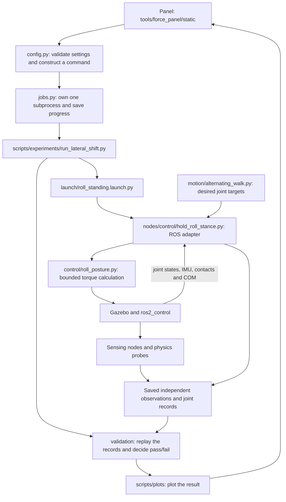

# 1. Understand the current project

Our current robot has **five joints in each leg**: hip roll, hip pitch, knee pitch, ankle pitch and ankle roll. Roll controls sideways leaning; pitch controls forward/backward bending. The modeled P54-profile robot weighs 22.28 kg. No arms or hip-yaw joints are implemented.

The original walking baseline was three slow placements: right foot, left foot, right foot. The current verified extension is ten placements with 75 mm nominal steps and 2× movement speed; see [the current result](../guides/LONGER_FASTER_WALK.md). The following paragraph explains the original 50 mm baseline. Every swing raises the sole 30 mm. Each landing is 50 mm ahead of the supporting foot; after the initial placement the trailing foot must move 100 mm. The body shifts over the new support before the next lift. This is finite quasi-static walking, not an indefinite dynamic gait.

## Five questions separate the responsibilities

| Question | Folder | Start with |
|---|---|---|
| What is the robot? | `model/`, URDF and configuration | `model/roll_stance.py`, `model/roll_geometry.py` |
| Where should its feet and pelvis go? | `motion/` | `motion/alternating_walk.py`, `motion/first_step.py` |
| What motor torque should we request now? | `control/` | `control/roll_posture.py` |
| What do the sensors actually report? | `sensing/`, sensing nodes and probes | `sensing/contact_state.py`, `nodes/sensing/show_center_of_mass.py` |
| Did the saved experiment meet its requirements? | `validation/` | `validation/alternating_walk_audit.py`, `validation/motion_audit.py` |

Python library paths in this table are relative to `src/my_robot_description/my_robot_description/`. ROS node paths are relative to `src/my_robot_description/`.

## Follow one experiment from button to result

The GUI does not calculate motor torques. The runner does not implement PID. The planner does not prove that its motion happened. The audit checks independently saved measurements rather than accepting a successful-looking animation.

## Learn the runtime loop

The posture node receives `/joint_states` and orders them according to the model's ten joint names. It obtains the target for the current **simulated** time. After checking fresh contacts, sole geometry and safety conditions, it calls the PID calculation and publishes `/roll_effort_controller/commands`.

Gazebo simulates those efforts and passive damping. The next joint measurement closes the loop. `/biped/imu` supplies pelvis safety measurements. Physics-stamped contact states distinguish an unloaded touching foot from a truly airborne foot. The COM observer records mass-weighted COM and sole corners separately from drawing markers.

## Units you must be able to explain

- Position and clearance: metres. `0.03 m = 30 mm`.
- Joint angles: radians. `1 rad ≈ 57.3°`.
- Angular velocity: rad/s.
- Contact force: newtons (N).
- Joint torque: newton metres (N m).
- Motion phase times: simulated seconds. Real-time factor changes wall pacing, not the planned simulated durations.

Motor **commands** are bounded torque requests. They are not a calibrated measurement of physical motor torque. Contact forces are separate physics measurements.

## Recommended reading order in VS Code

1. Open `model/roll_stance.py` and identify joint order and motor caps.
2. Open `motion/first_step.py`: inspect `angles()`, `pose()`, `sample()` and `guard()`.
3. Open `motion/alternating_walk.py`: find where the foot that landed becomes the next support.
4. Open `control/roll_posture.py`: explain feedforward, P, D, I, anti-windup and clipping.
5. Open `nodes/control/hold_roll_stance.py`: follow subscriptions → guards → plan → torque → publisher.
6. Open `validation/motion_audit.py`: show how the torque equation is independently recalculated.

Continue with [the walking code walkthrough](02-walking-code.md). Historical six-joint lessons are preserved in `docs/history/` and are labelled as earlier milestones.
