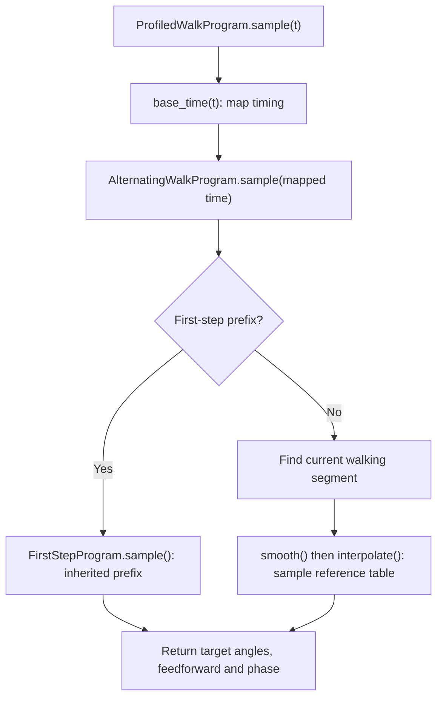

# Walking execution map

Source review: 2026-11-14. Scope: ready-state interactive walking through `interactive_sim.launch.py`. These are source-reviewed explanatory diagrams, not captured runtime traces. Optional load-feedback branches and startup waiting are omitted from the successful-update view.

## 1. Request permission to advance the plan

```mermaid
sequenceDiagram
    participant User as Terminal client
    participant API as CommandInterface
    participant Session as CommandSession
    User->>API: ROS /biped/controller/command (String JSON)
    API->>API: receive(): parse and check request ID
    API->>Session: command(action, steps, ready)
    Session->>Session: Check ready, busy state and capacity
    Session-->>API: Set target and running; return acceptance
    API-->>User: ROS /biped/controller/status (String JSON)
    Note over API,Session: Acceptance starts plan progress; it does not send torque or establish completion.
```

## 2. Successful repeated control update

```mermaid
sequenceDiagram
    participant ROS as ROS joint feedback
    participant Node as RollStanding.feedback()
    participant Session as CommandSession
    participant Plan as ProfiledWalkProgram
    participant PID as RollPosture
    participant Effort as Effort controller / Gazebo
    ROS->>Node: /joint_states (JointState)
    Node->>Node: Check timing; order q/v; check IMU
    Node->>Session: update(stamp, ready)
    Session-->>Node: Current plan time
    Node->>Node: Check contact/load/geometry guards
    Note over Node,Plan: Guards also query expected plan state.
    Node->>Plan: sample(plan_time)
    Plan->>Plan: base_time() then base.sample()
    Plan-->>Node: target_rad and feedforward_nm
    Node->>Node: Install target and feedforward; select gains
    Node->>PID: update(q, v, dt, gains)
    PID-->>Node: P/D/I, requested and clipped command
    Node->>Node: Check speed/headroom/posture bounds
    Node->>Effort: ROS /roll_effort_controller/commands (Float64MultiArray)
    Effort-->>ROS: Physics produces subsequent measurements
```

Read top to bottom. Function calls and ROS messages are labeled explicitly. Return arrows carry values; they are not additional ROS topics unless labeled ROS. IMU, contact and geometry callbacks update stored observations independently of this callback. Any required live guard failure prevents the normal publication path.

## 3. Open only the planner box



All arrows in this third diagram are local control flow. Plan construction and inverse kinematics happen earlier in constructors; this runtime view samples the prechecked tables.

## Code entry points

Paths below are relative to `src/my_robot_description/`.

- `nodes/control/robot_command.py`: terminal request publisher and acknowledgement subscriber.
- `my_robot_description/runtime/command_interface.py`: `receive()` and `publish()`.
- `my_robot_description/runtime/command_session.py`: `command()`, `update()` and `status()`.
- `nodes/control/hold_roll_stance.py`: `feedback()`, `imu()`, `contact()`, `lift_geometry()` and `supervise()`.
- `my_robot_description/motion/profiled_walk.py`: `sample()` and `base_time()`.
- `my_robot_description/motion/alternating_walk.py`: `sample()` and `guard()`; constructor builds later placements.
- `my_robot_description/control/roll_posture.py`: `update()` calculates bounded efforts.

## Completion

`CommandSession.update()` reaches the requested placement's hold boundary and sets `running=False`. The reference clock holds; feedback and torque calculation continue. `status()` reports `holding`. A measured experiment's audit verdict is a separate result.
